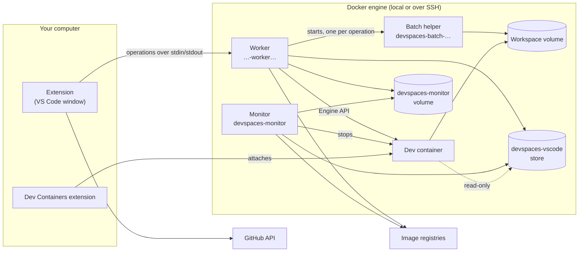
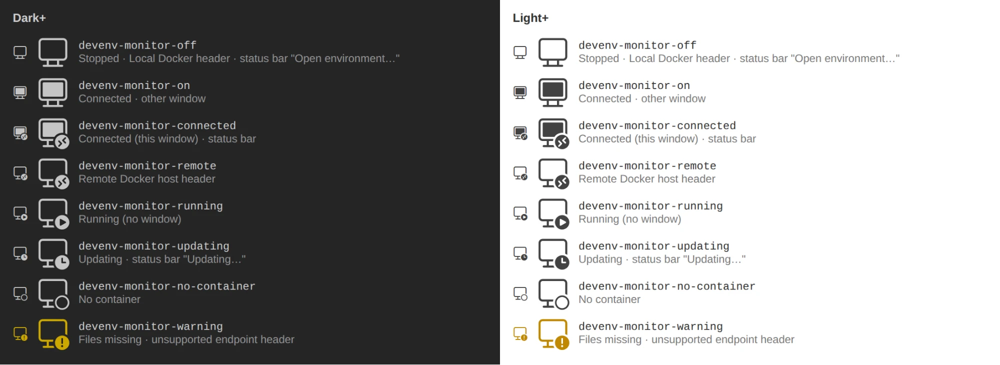

# Architecture

This document describes how Devspaces works inside: its components, the main flows, where it keeps its data, how it names things, and how it is tested. The user guide is [guide.md](guide.md); the security model is in [security.md](security.md).

## Overview

Devspaces opens a GitHub repository in a dev container, a *devspace*, on a Docker engine: the local Docker, or a remote engine reached over SSH through the current Docker context. A devspace is a Docker volume with a clone of the repository, an image built from its Dev Container configuration, and a container created from that image. The VS Code window connects to the container through the Dev Containers extension.



The rule that holds everything together: **the extension sets up the worker, and the worker does all work on the engine.** The extension decides, asks the user, keeps the local records, and holds the secrets. It sends the worker one operation per flow. The worker runs the whole flow next to the engine, so that a remote engine costs one SSH connection per window instead of one per Docker call. Local and remote engines work the same way; only the Docker context differs.

## Components

### The extension

The extension runs in the local extension host of each window (`extensionKind: ["ui"]`). It activates at startup and on `onResolveRemoteAuthority:attached-container`, so that a window that VS Code restores runs the open flow before it connects. Its code is in `src/vscode/` (the VS Code adapters) and `src/core/` (the logic, which never imports `vscode`).

Before the first use of Devspaces on the computer, the activation does no Docker work in the background. The first use is the first devspace: `registry.json` exists, or the marker `used` (see [The local records](#the-local-records)). Before it, the activation only reads the current Docker context, for the title of the view: it runs no `docker info`, restores no lost registry, builds no helper image, and starts no worker. When that read fails and `DOCKER_HOST` is not set, it also runs `docker --version` on this computer, to recognize Podman. The answer is kept until the file of the `docker` command changes, and calls at the same time share one run (`podmanCli` in `src/core/docker/bootstrapDocker.ts`). The window of a container whose name starts with `devspaces-` does this work also before the first use, so that it finds its devspace after its storage folder was lost (`backgroundWorkAtStart` in `src/vscode/windowDevspace.ts`).

Its parts:

- **UI**: the sidebar tree (`sidebar.ts`, `treeModel.ts`, `treeView.ts`), the status bar item, the switcher, the progress notifications, the welcome views with the Docker setup (on Windows, `wsl --status` runs only while the view shows the setup, at a click on Install WSL 2, and for up to 30 minutes after an installation started), and the repository groups editor (a webview with a strict content security policy). The regular expressions of the setting `repositoryGroups` never run on the extension host: the sidebar (`groupMatcher.ts`) and the preview of the editor run them in a worker thread, `dist/groupsPreviewWorker.js`, with a time limit: in the sidebar one second for each entry, in the editor one second for the whole preview. The sidebar keeps the places of the names until the setting changes; after the time limit, it lists the repositories without groups.
- **Discovery** (`src/core/discovery/`): lists the repositories with a Dev Container configuration through the GitHub GraphQL API. List requests read 100 repositories each; lookup requests check up to 50 repositories for `.devcontainer/devcontainer.json`, `.devcontainer.json`, and `.devcontainer/<folder>/devcontainer.json`. At most four requests run at the same time. The result is stored per account, with the repositories without a configuration (`withoutConfiguration`, with their data: the sidebar lists them with a default image), and a refresh looks up only the repositories whose `pushedAt` or default branch changed. With the setting `owners`, only those owners are asked.
- **Controller and operations** (`controller.ts`, `src/core/pipeline/devspaceOperations.ts`): turn each command into one worker operation, answer the worker's requests, and connect the window afterwards.
- **Bootstrap** (`src/core/docker/bootstrapDocker.ts`): the Docker CLI calls of the extension. It checks and starts Docker, checks and builds the helper image, starts the worker, tests a new remote host, and manages the Docker contexts. The only other Docker commands of the extension are those of **Remove Devspaces from This Docker Engine…** (`src/core/docker/engineRemoval.ts`, see [Remove from an engine](#remove-from-an-engine)), through the same runner, because that command also removes the worker. Every call of one operation runs with the Docker context that the operation read at its start (`DOCKER_CONTEXT`), so a switch in the middle cannot move it to another engine.
- **Session coordination** (`sessionCoordinator.ts`, `src/core/session/`): the window status files, the heartbeats, the release when a window closes or switches, and the sweep of the storage folder.
- **Connection** (`connectionAdapter.ts`): opens the folder URI `vscode-remote://attached-container+<hex of {"containerName": …}>/<folder>` with `vscode.openFolder`, and tells which devspace a window is connected to. Only this adapter and `src/core/devContainers.ts` know internals of the Dev Containers extension.

### The worker and the helper channel

The worker is a container per window and Docker engine, named so that `docker ps` shows which window it belongs to. In the window of a devspace, the worker on the engine of the devspace is `<devspace>-worker<number>`, after the resource name of the devspace (see [Naming](#naming)), for example `devspaces-acme-api-sturdy-kahn-worker1`. Every other worker is `devspaces-<window>-worker<number>`, for example `devspaces-api-worker1`, where `<window>` is the name that the title of the window starts with: the name of its saved workspace file, else the name of its first folder, else `window`; in lower case with only letters, digits, and `-`, and cut to at most 24 characters, at the end of a word where that keeps at least 12, so that a worker name is short (at most 43 characters up to the number 99). Without `-` before the number, a worker name is never the name of a container of Docker Compose (`<project>-<service>-<number>`, also of a service `worker`). The number tells apart the workers of windows with the same name on one engine (two windows of one folder, two devspaces of one repository on other engines, or the windows of two computers that use one remote engine). A worker starts with the number 1. When Docker refuses the name because another container has it, the extension lists the containers of the engine and starts the worker with the lowest free number (the next number when the list fails); an open fails when Docker has refused 10 names. The helper channel is its connection to the extension: the standard input and output of the `docker run` with which the extension starts it, with the Docker CLI over the engine's Docker context:

```text
docker run --rm -i --pull never --name <worker name>
  --label nimblescape.devspaces.worker-run=true --label nimblescape.devspaces.worker-channel=<protocol>-<hash>
  --network bridge --log-driver none --cap-drop ALL --security-opt no-new-privileges
  --mount type=bind,source=<engine socket>,target=/var/run/docker.sock
  --mount type=volume,source=devspaces-monitor,target=/state
  --mount type=volume,source=devspaces-vscode,target=/vscode,volume-nocopy
  --env DEVSPACES_VERSION=<version>
  devspaces-worker:<tag> node -e <pipe loader> /opt/devspace/channel.js <sha256> startChannel
```

The extension and the worker talk over the standard input and output of that `docker run`, one JSON message per line (`src/core/helperChannel/protocol.ts`). Both sides check every message strictly. After `hello` (protocol version 3), the worker answers `probe` with the version and identity of its engine, and runs `sweep`, which prunes stopped helper containers older than 10 minutes.

- **Operations** (`OPERATIONS` in `src/helperChannel/operations.ts`), one per flow, each with typed parameters: `open`, `prepare`, `stop`, `delete`, `deleteCheck`, `listConfigurations`, `refresh`, `windowState`, `tokenRemove`, `reconcile` (the registry rebuilt from the volumes), `heartbeat`, `recordGitState`, `monitorEnsure`, `monitorRunNow`, `probe`, and `sweep`. No Docker command crosses the channel.
- **Requests**: during an operation, the worker asks the extension through `ask` messages and waits for the answer: `question` (a dialog for the user), `local` (window state and other facts of this computer), `record` (a specific change of the local records), and `secret` (the GitHub token, or the login of the registry of one image or Feature, which the request names; the extension answers one request at a time and refuses a second one meanwhile, gives the logins of at most 8 registries in an open, and logs each request). Each operation may send only its own kinds of requests (`FLOW_REQUESTS`), and record changes only for its own devspace (`SCOPED_REQUESTS`).
- **Progress and output**: `progress`, `log`, and `out` messages go to the Devspaces log and the progress notification. The worker masks every secret of the operation in everything it sends.
- **Lifetime**: the extension opens a worker at the first operation on an engine and closes it after 10 minutes without one. It pings every 15 seconds. The worker ends by itself when its input ends, after 60 seconds of silence, or after 15 minutes without an operation; `--rm` removes it.
- **Engine access**: every Docker action of the worker goes through one port, `DockerEngine` (`src/core/worker/dockerEngine.ts`), over the Docker Engine API on the socket (`src/helperChannel/engineApi.ts`, `engineClient.ts`). The worker starts no `docker` process of its own. Every command that it runs in a container is a named entry of one registry (`CONTAINER_SCRIPTS` in `src/core/worker/containerScripts.ts`), run through `exec` with positional arguments, secrets only on standard input, and its output masked.
- **The pipeline**: the logic of the flows (`DevspaceService` in `src/core/pipeline/`, the host access policy in `src/core/policy/`, the image check in `src/core/imageCheck/`) runs only in the worker. A test checks that the extension's bundle contains none of it.
- **Network**: the worker has outbound network on the default bridge, and no published port. Its HTTPS goes through the proxy of the Docker daemon, with the header `User-Agent: nimblescape-devspaces/<version>`. The extension gives the worker its version in the variable `DEVSPACES_VERSION`, and the worker gives the same variable to the Monitor that it creates. No bundle holds the version, so a new version without a change of the code builds the same files.

### The helper image

All containers of Devspaces run from one image per engine, `devspaces-worker:<12 hex>` (the helper image of the code; Docker shows the name of the worker), built locally from `resources/helper/Dockerfile`: Node.js 24 on Debian, Git, the Docker CLI with Buildx and Compose, tini, `flock`, `setpriv`, the user `devspace-git`, and the Dev Container CLI of the exact version that `package.json` pins as a devDependency. The tag is a hash of the Dockerfile, the CLI version, and a generation number, so a change of any of them builds a new image.

After an installation or update, the extension builds a missing image in the background, before an open needs it, once Devspaces was used on the computer (see [The extension](#the-extension)); before that, the first Start or Refresh builds it. The extension also builds a missing image when a refresh finds it missing on an engine that answers ("Devspaces: preparing `<host>`…" in the status bar). A Start, Stop, or Delete builds it at once. While the image is missing, the rows of that engine show `State unknown`. The maintenance runs when a worker is prepared for an open, and in the background prebuild: a weekly check of the base image's digest, a rebuild with `--pull --no-cache` when the check found a newer base (only with `updateImagesOnConnect` on; a rebuild that takes longer than 15 minutes counts as failed), and a daily cleanup of helper images that no window used for 7 days. Its state is in `helper.json` (local engine) and `helper-remote-<hash>.json` (each remote engine).

### Pipe loading

The worker, its batch helpers, and the Monitor all get their code the same way (`src/core/loader/pipeLoader.ts`). The container runs a one-line `node -e` loader with the path, the SHA-256 hash, and the entry function of its bundle on its command line. The writer sends the bundle as the first line of standard input. The loader checks its length and hash, stores it in the container (`/opt/devspace/channel.js`, `batch.js`, or `monitor.js`), and calls its entry with the rest of the input. A container that restarts with a stored file of the right hash starts it without reading its input, which is how the Monitor survives a restart by Docker. Every failure of the loader exits with code 3. No code goes into an argument or a variable of a container.

The worker's bundle, `dist/helperChannel.js`, is one program with four uses, each with its own entry (`src/helperChannel/main.ts`):

- **Worker**: `startChannel`.
- **Batch helpers**: `startBatchHelper`.
- **Monitor**: `startMonitor` (`src/remoteMonitor/main.ts`). The commands over `docker exec` run `node /opt/devspace/monitor.js <command>`.
- **Host access analysis**: threads of the worker (`src/core/helper/configurationAnalysisWorker.ts`). The worker starts each thread from its own stored file, after it checked the SHA-256 hash of that file again.

Nothing in the bundle runs with `eval`. The bundle holds fixed scripts as text, which run with `node -e` or `sh -c`: the one-line pipe loader, and the scripts that the worker and the steps of the batch helpers run in containers.

### The batch helper

The worker starts before any devspace is chosen, and a running container cannot get a volume mounted later. So the steps that need the volume of a devspace run in **one batch helper per operation** (`devspaces-batch-<session>`), which the worker starts over the Engine API with that volume, the pinned helper image, and the helper's cache volume (`devspaces-worker-cache`). It checks first that the volume exists, so a mount never creates an empty volume without labels.

Its steps are the fixed kinds of `src/core/helper/batchSteps.ts`: `clone`, `readFiles`, `listConfigs`, `readConfiguration`, `build`, `composeModel`, `composeHash`, `createFolders`, `up`, `runUserCommands`, `gitFiles`, `ownershipFix`, and `repositoryOwnershipFix`. The worker sends a kind and its parameters; the helper checks them strictly and builds the command itself. It never runs a command line that it was sent. The clone runs as the user `devspace-git`; the steps that read the repository run as the owner of the repository folder; the steps that need Docker run as root (see [security.md](security.md#trust-boundaries)). The build and `up` run the Dev Container CLI, which uses the Docker CLI and Docker Compose of the helper.

### The Monitor

Each engine has one Monitor, the container `devspaces-monitor`, made from the helper image under the second tag `devspaces-monitor:<12 hex>`. It has the label `nimblescape.devspaces.monitor`, no published port, no capabilities, `no-new-privileges`, outbound network on the default network, and a JSON log of at most 2 × 1 MB. It mounts the engine's socket, its volume `devspaces-monitor` at `/state`, and the store `devspaces-vscode` at `/vscode`.

The worker makes sure that it runs (`monitorEnsure`, and at every open): it creates it when it is missing, and replaces it when its script, image, or mode differs, or when its restart policy is not the one of its mode (for example `no` after it ended itself). The script of the Monitor is the worker's bundle, so each change of that bundle (most updates change it) replaces the Monitor of an engine once, at its next ensure. An update that leaves `dist/helperChannel.js` unchanged keeps the Monitor, which then still sends the version of Devspaces that created it in its header User-Agent. An open that cannot ensure the monitor is refused. On every engine, local or remote, the monitor runs permanently with the restart policy `unless-stopped` once the user answered the question about it on that engine, unless `stopMonitorWhenIdle` is on. Otherwise it has `on-failure` and exits after 5 minutes without a running devspace (never during a background run). The question (`src/vscode/monitorQuestion.ts`) comes once per engine (one question per engine at a time in a window; two windows that start at the same moment can both ask, and the last answer counts), before a Start, a Rebuild, or **Update All Images Now** of the user, and only while `stopMonitorWhenIdle` is not on; the flows that run by themselves (the reopen at startup, a restored window, a pending operation, the repair of the heartbeats) never ask. **Keep Running** writes `false` and **Stop When Idle** writes `true` into the user setting `stopMonitorWhenIdle`, and then the engine is recorded as answered in `docker-engines.json`; a closed question stores nothing. While another window removes Devspaces from the engine (its entry `removing`, see [Remove from an engine](#remove-from-an-engine)), the answer is not recorded for the engine, because the removal mark forgot it, and the next flow there asks again. The mode is fixed in the restart policy and the environment of the monitor, so a change of the setting or of an answer reaches the monitor of an engine only at its next ensure (an open there, **Update All Images Now**, or the repair of a missing monitor); until then, a monitor that keeps running goes on. A permanent monitor carries the ID of the computer that created it (the label `monitor-owner`). An ensure that wants a monitor that ends when idle (with `stopMonitorWhenIdle` on, or before the answer) replaces only its own computer's permanent monitor and keeps one that another computer owns, so a computer with the setting on never replaces a permanent monitor that another computer created; when the computer that created it turns the setting on, it replaces it, and a computer with the setting off and the answer makes it permanent again at its next ensure. A replacement ends a background run that runs in it; the next monitor runs it again, because its end was never stored.

A permanent monitor ends itself after 30 days without a use (`UnusedEnd` in `src/remoteMonitor/main.ts`). Each subcommand of a window (a heartbeat, the image references and the settings of an open, **Update All Images Now**, the `forget` of a Delete) is a use: the monitor writes its time into `/state/last-use.json`, at most once an hour, with the nonce of its creation. A new monitor counts its creation as a use; a restart of the same container does not. When the last use is 30 days old at two checks one hour apart, the monitor sets the restart policy of its own container to `no` over the Engine API and exits with 0, never during a background run. Docker then leaves the container exited, also after a restart of the engine, and the next ensure replaces it. A time in the file that is later than the clock counts as a use now, in memory only: the monitor writes the time of the clock only when the clock is still behind at a second look one hour later, and a subcommand never moves the time earlier, so a clock that is set back and set right again within the hour keeps the last use. A clock that stays behind longer can make the monitor end early; the next ensure creates it again. From the first check that found the time without use until a use comes again (the monitor reads the file at each check meanwhile), a background run that is only due does not start (it would hold the end back), while a run of **Update All Images Now** still runs. A use that comes while the monitor ends (the ensure of a window can accept it just before its policy changes) sets the restart policy back to `unless-stopped`, and the monitor goes on; a request of **Update All Images Now** without such a use runs before the exit.

The monitor has two jobs: stopping devspaces that no window uses (see [Heartbeats and stops](#heartbeats-and-stops)), and the background run.

### The background run

The background run (`src/remoteMonitor/background.ts`) runs at the times of the setting `cacheUpdateSchedule`, which reaches the monitor with each open: a cron expression in the time zone of the computer, or an interval in minutes. The monitor checks every minute whether a run is due, keeps the end of its last run in `/state/cache-run.json`, and runs a missed time once when it runs again. **Update All Images Now** (`monitorRunNow`) writes `/state/run-now.json`, which the next check takes. At most one run runs at a time. Its parts run one after the other, and each fails on its own:

1. **Images in use** (`src/remoteMonitor/images.ts`). Each open sends the image references of the build records of all devspaces of its computer on that engine; the monitor keeps them per computer (`images-in-use.<source>.json`) and uses those of the last 30 days. It asks each registry anonymously for the digest of each tag, stores the answers (`registry-digests.json`), and pulls a tag when the registry has a newer image of it. It never pulls a reference pinned by a digest, and never pulls over an image that was built on the engine. Of the repositories of those references, it keeps the image that each tag points to, every image that a container uses, and every image that another image is built on, and removes the others without force. It never touches an image of another repository.
2. **VS Code server**: the newest stable server, and the newest Insiders server while an open used Insiders on that engine within 14 days, downloaded into the store. A new server is linked into the running dev containers that mount the store, so that a window that VS Code restores after its update finds its server.
3. **Extensions**: the newest compatible releases of the extensions that the opens of the last 14 days named, downloaded from the Marketplace into the store.
4. **Cleanup**, at most once a day: server versions that no open used for 14 days, that are not among the two newest, and that no running container runs; extension files that no recent list names, or that a newer chosen file replaced.
5. **Prepares** (`src/remoteMonitor/prepares.ts`): for each devspace of the engine, one at a time and the most recently used first, the monitor runs the worker's code as a child process in its own container and sends it the operation `prepare`. The worker that ensured the monitor stored its script in the monitor's volume (`worker-scripts/<sha256>.js`) for this.

### Registry answers

The open asks the registries for the current digests of the images and Features of a devspace with HTTP `HEAD` requests, in parallel, within 5 seconds. Each request goes first without a login, with an anonymous token when the registry asks for one (`src/core/imageCheck/registryClient.ts`). The worker asks the extension for the login of a registry only when the registry refuses this request (HTTP 401 or 403, or a token service that refuses the anonymous token), or answers 404, which some registries give for a private repository; after a 404, the request goes again only with a login. A login that the registry refuses is logged, and the answer without it counts. For a reference that the monitor's last pass answered, it takes the stored answer instead, while that answer is younger than the time between two runs of the schedule plus 5 minutes. So an open agrees with what the monitor pulled and prepared. Private images, Features, unanswered references, and the answers of a monitor that has not run recently are checked by the open itself. The answers are freshness data only; no security check uses them.

### Prepare and swap

A **prepare** (`DevspaceService.prepare`) builds the next image of a devspace before an open needs it. It runs the steps of the open up to the build, without any UI, token, or credential, and without changing a container:

- It skips a devspace without a volume, without a valid build record, with a configuration on another branch or with another hash than the record's, with the host access checks off, or whose configuration the policy refuses. It checks the image references of the build record first, so a devspace where nothing moved costs no helper and no build.
- It pulls the changed images anonymously and builds the new image as `devspaces-<…>:prepared` (for Docker Compose, only the image of the dev service; the other built services get `:prepared-<service>`), with `--frozen-lockfile` when the repository has a `devcontainer-lock.json`, so a prepare never writes into the working copy.
- The prepared image carries the label `nimblescape.devspaces.prepared`: the key of the update (the configuration and the digests, as the open computes them) and the ID of the helper image.
- A prepare holds a prepare lock of its own (`locks/<id>.prepare.lock`), never the devspace lock. It stops after 30 minutes; a build that failed or was stopped records its key (`<id>.prepare.stopped`), so the same update is not tried again. A Delete stops a running prepare first (`<id>.prepare.stop`).

At an open that updates a devspace (after **Continue** or **Update Now**), the **swap** takes the prepared image when its labels fit the open's own key, devspace, and helper image: it becomes the next numbered image, without a pull or a build. While a prepare of the devspace runs, the open waits for its lock, in steps of a minute. Every check of the open runs on the prepared image as on a built one. An image that does not fit is removed with the old images.

### The shared VS Code server and extension store

One volume per engine, `devspaces-vscode`, holds the VS Code servers and the extension packages that all dev containers of the engine share. Only the worker and the monitor write it, each file under a lock in `locks/`. A dev container that an open of the official VS Code build creates mounts it read-only at `/opt/devspace/vscode`.

- `server/<quality>/<platform>/<commit>/`: an unpacked server, for `linux-x64` or `linux-arm64`. The open sends the commit and quality of the window's VS Code (only for the official build); the worker downloads a missing server from the VS Code update service, checks its SHA-256, and moves it into place. Before the window connects, the worker links `~/.vscode-server/bin/<commit>` (for VS Code Insiders `~/.vscode-server-insiders/bin/<commit>-insider`) in the dev container to it, as the remote user, so the Dev Containers extension installs no server. A failure never fails the open: the Dev Containers extension then installs the server as usual.
- `extensions/<universal|linux-x64|linux-arm64>/<publisher.name-version>.vsix`: extension packages. Each open records the extensions of the devspace (`customizations.vscode.extensions` of the merged configuration, and the user's `dev.containers.defaultExtensions`); the monitor downloads them in its background run, with the extensions that the VS Code server installs with them (their `extensionDependencies` and the extensions of their `extensionPack`). Before the window connects, the worker copies the matching packages, those of the dependencies too, into the container's `~/.vscode-server/extensionsCache` (for VS Code Insiders `~/.vscode-server-insiders/extensionsCache`), from where the VS Code server installs them without a download. An open never downloads an extension and never waits for one.

### Heartbeats and stops

The Monitor stops devspaces by records in its volume, never by asking the windows.

- **Heartbeats.** Each window sends a heartbeat every 30 seconds through its worker (`heartbeat`, which runs `monitor.js heartbeat` in the monitor under the lock of the records) for the devspace that it is connected to and for the devspaces it is busy with. A record, `/state/heartbeats/<computer id>.<devspace id>.json`, holds the time of the engine, whether to keep running, a limit (`stopAfterMinutes`), and a sequence number. Every open sends the first heartbeat of its devspace. After two failed heartbeats in a row, the window warns with the time left.
- **Release.** When a window closes, switches, or leaves a devspace, it records the Git state of the devspace (`recordGitState`) and sends a release: a record with a limit of 5 minutes. At a close, this must finish within 2 seconds of `deactivate()`. A lost release leaves the long limit of the last heartbeat.
- **Keep.** **Keep Running When Closed**, **Close and Keep Running**, `stopOnClose` off, and a respected `"shutdownAction": "none"` make the heartbeats say *keep running*, and the window sends no release.
- **Stop.** A manual **Stop** first sends a *stop now* record. The monitor stops the devspace at its next tick, about 15 seconds later, unless a newer record of any computer came since. The window's own `stop` operation runs at the same time and is usually first.
- **Rules** (`src/remoteMonitor/rules.ts`). The monitor ticks every 15 seconds. For each devspace with a running container, the newest record of any computer decides: keep running, or stop once its limit passed. A release never shortens the live record of another computer. After the monitor starts, or after a pause of the engine, it stops nothing for 5 minutes, so that the windows can send again. It never acts on a devspace that nobody sent a record for, or on a container without the label `nimblescape.devspaces.id`. Before a stop it takes the devspace lock without waiting; a held lock moves the stop to a later tick.

The monitor stops the dev container first, then the other containers of the devspace. It records no Git state; the window does that at its release, and the next open records it again.

### Locks

- **Devspace lock**: `/state/locks/<devspace id>.lock` in the volume `devspaces-monitor`, which every worker and the monitor mount. The flows `open`, `listConfigurations`, `stop`, and `delete` take it with `flock` on the engine, and hold it until the flow ends, also while a question to the user is open. Another window or computer waits 10 seconds for it, then is refused with a message that the devspace is busy. The lock files are opened without following links and are never deleted. A process that ends frees its lock.
- **Prepare lock**: `/state/locks/<devspace id>.prepare.lock`, held by a prepare.
- **Store locks**: `devspaces-vscode/locks/`, one per server version and per extension package, so that two windows and the monitor never download the same file twice.
- **Records lock**: `/state/.heartbeats.lock` for the heartbeat records.
- **Local registry lock**: the read-modify-write of `registry.json` runs under a lock folder created with `mkdir` (`registry.lock`); a lock older than 10 seconds counts as stale. The holder writes a random token into the folder. Before its write and before it removes the folder, it checks that the token is still its own: a window that stopped for more than 10 seconds (for example while the computer slept) may have lost the lock to another window. Then it writes nothing, leaves the folder alone, and runs its change again on the current file. The write checks the token a second time after it wrote its temporary file, right before the rename. Only the very short time between this last check and the rename is not covered: a window that stops exactly then still writes its old copy. A change of `docker-engines.json` runs under its own lock folder of the same kind, with the same checks of the token (`docker-engines.lock`, `src/core/storage/lockFolder.ts`), so that two windows never lose a removal mark, the entry of a removal that runs, or an answer of each other. Like `registry.json`, it is read with the retries of a transient error of Windows, and a change fails when the file cannot be read, so it never writes over the records of other engines; before a change writes over a file that is not valid, a copy is kept (`docker-engines.json.backup-<time>`).

### The local records

The extension keeps its records in its global storage folder on your computer. Every JSON write is atomic (a temporary file, then a rename).

| File | Content |
|---|---|
| `registry.json` | The devspaces: ID, repository, owner account, Docker host, source (the configuration path, or the default image the devspace was created from), build record (the image, its pinned ID, the digests of its images and Features, the configuration hash, the default image it was built from), the last known branch and Git state, flags such as `keepRunning`, busy marks, and the volumes that a Delete kept. |
| `repositories-<account id>.json` | The discovery result of one GitHub account, with the scope it was built with. |
| `sessions/<window id>.json` | The status of one window: its devspace and its state; for a window that works without Devspaces on an engine with the removal mark, that devspace apart (`plainDevspaceId`). |
| `pending/<devspace id>.json` | A window that is connecting to a devspace. |
| `operations/<devspace id>.json` | An operation that a window hands to the window that reconnects, for example a rebuild. |
| `disconnect/<devspace id>.json` | A request to the window that is connected to a devspace to close its connection first. |
| `reopen.json` | The devspace of the window that closed last, for the reopen at startup. A window that is not connected to a devspace removes it when it closes. |
| `computer.id` | A random ID of this installation, the source of its heartbeats. |
| `used` | An empty marker: Devspaces was used on this computer. The activation writes it while `registry.json` exists, so that a lost `registry.json` still counts as a use. |
| `checks/<devspace id>.json` | The remembered result of the host access check of the configuration (see below). |
| `helper.json`, `helper-remote-<hash>.json` | The state of the helper image of each engine. |
| `remote-docker.json` | The context that was current before a switch to a remote host, and the "Don't Ask Again" answers. |
| `docker-engines.json` | Per Docker engine (by its Docker host): when the user answered the question about its Monitor, the removal mark of **Remove Devspaces from This Docker Engine…**, and the removal that runs in a window (`removing`; see [Remove from an engine](#remove-from-an-engine)). |

A devspace belongs to one Docker host, recorded with it; every view and operation acts only on the devspaces of the current host. When the registry is lost, `reconcile` rebuilds its entries from the labels of the workspace volumes (one entry per repository, account and source; the source from the label `config-path` or `default-image` of the volume, and for a volume of version 0.5.0 or older from the build record of the newest devspace image, so that a default-image devspace keeps its kind and a devspace of an alternative configuration keeps its configuration), and the build record from the labels of the newest image of each devspace. At a start of VS Code, the extension runs it in the background only after the first use (see [The extension](#the-extension)); **Refresh** and the first open of a repository run it at any time. A record change of the worker never changes the source of an entry: a default image is recorded only for a default-image devspace, and a selected configuration only when it is the configuration of the devspace.

The **remembered check result** lets an open skip the two runs of `devcontainer read-configuration` and the host access analysis when nothing changed. Its key covers the exact text of `devcontainer.json` and of the Dockerfile, the configuration path, the repository, the volume, the devspace ID, the full ID of the existing container, the ID of the helper image, and the switch of the host access checks. It is kept only when there is a container and the check passed, and only by the extension.

## The main flows

### Open

**Start**, **Switch Devspace…**, a link to Devspaces, a reconnect, a restored window, and the reopen at startup all run the same open flow.

1. **In the extension**: find the devspace of the signed-in account for the repository and the source (or none), read the Docker context, check the SSH login of a remote host, start Docker on the local engine if needed, prepare the helper image, and open the worker. Then send `open` with the registry entry, the settings, the VS Code commit, the default extensions, the image references in use of this computer, and the source of the open (`DevspaceSource`, `src/core/devspaceSource.ts`): for an existing devspace its own source, fixed at its creation (its configuration, or the default image, with the image of the settings now so that a changed setting is noticed); for a first open the source of the row, or the one picked for a repository with several sources. A devspace is one of a repository, account, Docker host and source; the devspaces of two sources of one repository run next to each other, with a lock per devspace.
2. **Lock and monitor**: the worker takes the devspace lock, ensures the Monitor, sends it the first heartbeat of the devspace, the schedule, and the image references, and starts the check of the VS Code server in parallel.
3. **First open**: a confirmation for a repository of a foreign owner (a link asks before step 1, in the extension: `Controller.openLink`); a new random devspace ID; the workspace volume, created with the labels of the devspace and checked to be its own; the clone, in the batch helper, with the token that the worker asks for.
4. **Configuration**: read the files and run `devcontainer read-configuration` (plain and merged) in the batch helper, or take the remembered check result. For Docker Compose, read the model with `docker compose config` as the owner of the repository. With the default image, the files of the repository are not read: the worker synthesizes the configuration `{ "image": "<default image>" }`, which `read-configuration` reads as `--override-config` under the configuration path of the devspace, and `build` as our copy of the configuration (`--config`), like our copy of a Docker Compose configuration. Run the host access analysis in a thread of the worker. A refused configuration ends the open with a message that names each setting.
5. **Image check**: compare the digests of the registries (or the monitor's answers) with the build record. A changed configuration or a changed default image of the settings asks **Rebuild now** or **Later**. No open changes the source of a devspace; a registry rebuilt from the volumes reads the source from the labels of the workspace volume, or, for a volume of an older version, from the build record of the devspace image.
6. **Update question**: when a newer image is available and the devspace has a container, ask as `updateContainer` says (**Continue**/**Cancel** or **Update Now**/**Later**).
7. **Image**: take a prepared image that fits, or pull and build with `devcontainer build`. A pull goes first without a login; it asks for the login of the registry only when the registry refuses it or does not find the image, or when Docker Hub limits pulls without a login. Label the image with the devspace ID, repository, owner, and build record by committing a created, never started container with `LABEL` changes, and pin its ID in the registry. A failed pull or build, or a new image that the checks refuse, starts the existing container instead.
8. **Container**: `devcontainer up` with an override configuration (`--override-config`): the image, the workspace mount, the workspace folder, the `runArgs` of the repository rewritten by the policy, the labels and name of the devspace, the tmpfs `/run/devspace`, the read-only store, the container-only Git variables, the per-container settings of the Dev Containers extension, and `shutdownAction: none`. It runs with `--skip-post-create`, after a check of the image metadata. An update replaces the container with `--remove-existing-container`; the volume stays.
9. **Container setup**: write the token into `/run/devspace`, write the Git files and a missing `~/.gitconfig`, fix the ownership of the workspace, run the lifecycle commands with `devcontainer run-user-commands`, link the VS Code server, seed the extensions, and record the Git state.
10. **Connect**: the operation records a pending connection for the other windows of this computer, and returns the container, the remote user, and the folder. The lock is released, and the extension opens the folder URI. The window's own heartbeats follow.

A container whose setup version (`nimblescape.devspaces.container-version`) is older than the extension's is created again from its image; so is a container created while the configuration could not be read, or while the host access checks were off and they are on now. A damaged container (for example one whose `/etc/passwd` lacks the user) is created again only after the user confirms.

### Stop

1. If a window is connected to the devspace, the extension asks that window to close its connection first (a disconnect request), and that window hands the stop over.
2. The window sends the *stop now* heartbeat to the Monitor, within 5 seconds.
3. The `stop` operation takes the devspace lock, records the Git state from the dev container, and stops every running container of the devspace, the dev container first.
4. The extension removes the reopen record of the devspace, so it is not reopened at the next start of VS Code, and shows `owner/name stopped.`

### Delete

1. `deleteCheck` refreshes the Git state from the running dev container (a failure falls back to the recorded state) and lists the additional volumes that Delete may remove: those with the labels of this devspace that no other devspace records.
2. The confirmation shows the recorded uncommitted changes, unpushed commits, and stashes, with **Delete anyway**, **Open devspace**, and **Cancel**, and lets the user tick the additional volumes.
3. A connected window closes its connection first.
4. The `delete` operation takes the devspace lock, stops a running prepare, removes the records of the devspace from the Monitor, and removes the containers, the images of the devspace (also `:prepared` and the images that Docker Compose built for it), the base images that no other image uses, the networks of the Compose project, the workspace volume, and the confirmed additional volumes. It removes only what carries the devspace's labels.
5. The extension removes the registry entry and the remembered check result, and records the additional volumes that stay, with their account, so that other accounts cannot mount them.

### Refresh and window state

The sidebar reads the states of the devspaces of the current engine with `refresh` (at most 200 per call): container states, branches, and Git counts. While the registry has no devspace on the current engine, the sidebar reads nothing: no `docker info` and no worker. A window that is connected to a devspace reads its own container with `windowState`. When the worker cannot be prepared or the engine does not answer, the rows of that engine show `State unknown` and keep their actions; the registry is not changed.

### Reopen at startup

VS Code restores the windows of the last session; a restored window that was connected to a devspace runs the open flow before it connects, and switches the Docker context back after a question if the devspace is on another host. When VS Code starts with an empty window instead, the extension opens the devspace of `reopen.json` if `reopenLastOnStartup` is on, no other window is alive, no operation is pending, no Start of the user runs in the window (also not one that still asks about the Monitor: a Start takes its request to connect the window before that question, and the newest request connects the window), no link to Devspaces is opening in the window (`Controller.openLink`; a reopen that started before the link does not connect the window while the link runs), and the record is older than 5 seconds (a younger one means that the user chose **Close Remote Connection**). Each window changes the record when its extension host stops, which happens when the window closes and also at each reload of the window (`SessionCoordinator.deactivateSync`): a window that is connected to a devspace writes the record of its devspace, and any other window removes the record (a local window, the window of another remote, a window that works without Devspaces, or a container window whose devspace is not known yet). A window that closes before its session started leaves the record as it is. So the record names a devspace only when the window that closed last was connected to it, and a local window that closes last opens nothing at the next start, also while devspaces still run. When VS Code quits with several windows, their extension hosts end at about the same time, and the window that ends last decides. A manual **Stop** removes the record of its devspace.

### Remove from an engine

**Remove Devspaces from This Docker Engine…** (`removeFromDockerEngine` in `controller.ts`, and `src/core/docker/engineRemoval.ts`) acts on the engine of the current Docker context.

1. It is refused for an endpoint that is neither local nor SSH, while a window of this computer is connected to a devspace on the engine or is opening one (its pending connection file, at most 2 minutes old, also of this window), while an operation runs (in this window, also **Update All Images Now** until the Monitor took its request, or with a busy mark of another window), and while another window removes Devspaces from the engine (step 4). It never starts Docker: when the engine does not answer, it removes nothing.
2. It lists what Devspaces keeps there: the Monitor containers (label `monitor`), the helper containers (label `worker-run`: the workers of every window and their batch helpers), the helper images (label `worker`), and the shared volumes `devspaces-monitor`, `devspaces-worker-cache` and `devspaces-vscode` that exist. It also looks for devspaces that this computer does not know (the label `id` of containers and volumes) and for a Monitor that another computer keeps running (`monitor-owner`); the confirmation then says that other computers use the engine.
3. After the confirmation, a second one asks whether the devspaces of the signed-in account on the engine are deleted too, with their recorded Git changes. Devspaces of other accounts stay.
4. The engine gets the removal mark in `docker-engines.json`, which also forgets the answer about its Monitor, and in the same change the entry of the removal (`removing`: the window, its process and the start). Then the checks of step 1 run again, also for a devspace that was created meanwhile: when a window connected, began to open a devspace, or an operation began while the questions were open, the removal stops before it removes anything, and the record from before comes back. While the window of the entry lives (the liveness rule of the busy marks, `isBlockingBusyMark`, so a window that crashed blocks nothing), a Start, a Rebuild and **Update All Images Now** of another window on that engine are refused with a message (`Controller.beforeUserFlow`): they would clear the mark while Devspaces is removed. **Update All Images Now** checks again after its step "Docker start", which can take long, right before its request (`Controller.requestRefusedByRemoval`): while a removal runs, in this window or in another one, and when a removal left a new mark there in the meantime, it sends no request, which would set up the Monitor, the worker and the volumes there again. Its request has no busy mark, so a removal that another window begins after this check does not see it, and the request can set them up again (the guide says to run the command again then). Every other operation of another window there (a Stop, a Delete, the operation of a hand-off) is refused with the same message (`Controller.operation`, and a Stop before it tells the Monitor), also when the worker of that window is open, so that no worker builds the helper image or creates the volumes there again while they are removed. For the same reason, no window restores a lost registry from the volumes there while the removal runs (`Controller.restoreRefusedWhileRemoving`, also in the window of the removal); a **Refresh** says so, and a restore in the background only logs it. The check runs when the mark would be cleared, again under the lock of the file, and once more after the question about the Monitor, which also clears the mark of a removal that began and ended while the question was open. A second removal there is refused too, at its start and again under the lock when it would write its own entry. At the end of the removal the entry goes, and the mark stays. While the mark is set, this computer does no Docker work there by itself: no background work at the start of VS Code (also no restore of a lost registry by the window of a devspace container, `findWindowDevspace`), no reopen of the last devspace at startup, no `docker info` and no worker for the refresh of the sidebar, whose rows of the devspaces there show `State unknown (Devspaces removed from …)` (`engineRemoved` of `DevspaceOperations.refreshStates`; the log says so once per engine in a window), and no background build of the helper image. A window of a devspace there (role A: restored by VS Code, from Open Recent, or attached by hand) starts its session without the devspace, so it sends no heartbeat, whose repair would create the Monitor again, and no release when it closes. A heartbeat of any window that finds no worker there does not prepare one (`engineRemoved` of `heartbeatWiring`), so it neither builds the helper image nor creates the volumes that the worker mounts. The account rule still applies there, as on any engine: when the signed-in account may not use the devspace (another account's, or nobody is signed in), at the start of the window or after a sign-out or a change of the account, the window closes after the token of its owner left the container through the worker, also when this builds the helper image and creates the volumes `devspaces-monitor` and `devspaces-vscode` there again. The window of a devspace of the account runs no open pipeline and no Docker work, and it stays connected as a plain container window, so the user can still reach the files of a kept devspace; one line in the log and one information message say so (`Controller.workWithoutDevspaces`). When the registry lost its content, nothing is restored there, so the window reads the labels of its container with one plain `docker container inspect` (the id label of the Dev Container CLI, and the repository and owner labels of the devspace image; `removedEngineWindowDevspace`): the window of a devspace of the account works without Devspaces as above, the window of another account's devspace closes in the same way, and a window whose owner cannot be read closes too, after the token removal when the labels name the devspace (`Controller.leaveUnknownOwner`); when it keeps its connection (Cancel on unsaved files), it closes it again, as for the devspace of another account, also when only the container name is known. A **Refresh** of the user restores a lost registry there and keeps the mark; a window whose devspace it restores works without Devspaces too, after the account rule (`adoptWindowDevspaceNow`). Its status file names that devspace apart from the devspace of the window (`plainDevspaceId`), with the Docker context of the window, so the removal is refused while the window is attached to it, and a Stop, a Rebuild or a Delete of it, in this window or in another one, closes the connection of the window first, as for a connected window. A Start of it in another window shows this window instead of opening a second one, and a Start in this window (also **Start in New Window**, or with `openInNewWindow`) connects this window, as a Reconnect: as for a connected window, the worker reads the state of the container first (once the Start cleared the mark), a container that runs only connects the window again, without the open pipeline, and one of an older version stays as it is while the window leaves it; only a container that does not run goes through the pipeline. The release of another window and the checks of the worker before they stop or replace a container (`otherWindowUsesDevspace`, `otherWindowMayUseDevspace`) count the window as connected to it. A Stop or a Delete of a devspace that the user kept there keeps the mark: its worker builds the helper image and creates the volumes `devspaces-monitor` and `devspaces-vscode` again (the log says so for the image), but no heartbeat starts the Monitor there again (`engineRemoved` of `WindowHeartbeats`), and a new run of the command removes them. A Start, a Rebuild, or **Update All Images Now** of the user there clears the mark. From the end of the checks of step 1 to its end (also while it lists and asks), a second run and the other operations of the window are refused. When the mark cannot be written, the last message of the removal says that the background work of this computer may set Devspaces up there again.
5. With **Delete Devspaces Too**, the worker deletes each devspace as Delete does, with all its recorded additional volumes, one after the other. A devspace that a window attached to meanwhile (this window or another one), or that a window is opening, is not deleted; the last message counts it as left.
6. The background builds of the helper image of the window on that engine stop, and the removal waits for their end (the prebuild at the start, `HelperPrebuild`, and the build of a missing image, `MissingHelperBuild`), so that neither makes the image again. It waits at most 30 seconds (`HELPER_BUILDS_STOP_WAIT_MS`; then the removal goes on, and the log and its last message, a warning then, say that such a build may make the image again), and Cancel ends the wait and the removal. Those of other windows go on: a build that another window began before the mark can tag the image again after its removal, because the end of a build does not check the mark (the guide says to run the command again then). The worker of the window ends, and the extension removes with the Docker CLI, each kind listed again right before its step: the Monitor containers and the helper containers (`docker rm -f`), the helper images (`docker image rm`, never with force: the tags of `devspaces-monitor`, then those of `devspaces-worker`, then the images without a tag), and the shared volumes. An item that fails does not stop the later ones; after a failure, the removal ends when the engine does not answer anymore. Each item is logged with its outcome, and each one that is left with the command that removes it. A removal that ends early (Cancel, also while the devspaces of step 5 are deleted, or an engine that stops answering) logs the commands that remove the rest (`removalEndedNote`).

## Where the data lives

| Place | What |
|---|---|
| Global storage of the extension (your computer) | The local records above. |
| Workspace volume `devspaces-<owner>-<repo>-<source>-<adjective>-<scientist>` | The clone under `/workspaces/<name>`, and `/workspaces/.devspace+` with `gitconfig`, `credentials.gitconfig`, `docker/`, and `gh/config.yml`. |
| Additional named volumes | Volumes that the configuration mounts; Devspaces creates them with the labels of the devspace. |
| Volume `devspaces-monitor` (`/state`) | Heartbeat records (`heartbeats/`), locks (`locks/`), the image references in use, the registry answers, the image bookkeeping of the monitor, the schedule state (`cache-run.json`, `run-now.json`), the time of the last use of the engine (`last-use.json`), the extension lists of the opens (`extensions/`), and the stored worker scripts (`worker-scripts/`). |
| Volume `devspaces-vscode` | The shared VS Code servers and extension packages. |
| Volume `devspaces-worker-cache` | The user data folder of the Dev Container CLI in the batch helper. |
| Dev container | `/run/devspace` (tmpfs: `github-token`, `gh/hosts.yml`), `/opt/devspace/vscode` (the store, read-only), and `~/.vscode-server/bin/<commit>` or `~/.vscode-server-insiders/bin/<commit>-insider` (a link into the store). |

## Naming

- **Devspace ID**: a random UUID, which appears only in labels. Its *pair* `<adjective>-<scientist>` comes from the SHA-256 of the ID (`src/core/namePairs.ts`); an ID whose pair is in use on the engine is not taken.
- **Resource name**: `devspaces-<owner>-<repo>-<source>-<adjective>-<scientist>`, lower case, at most 63 characters. It names the workspace volume and the dev container. `<source>` is the word of the source of the devspace (`sourceSegment`): `default` for the default image, `config` for the configuration at the root of the repository (`.devcontainer/devcontainer.json` and `.devcontainer.json` are the same configuration), and the folder name of another configuration (`python` for `.devcontainer/python/devcontainer.json`), cleaned like the rest of the name and cut to at most 24 characters; the same word labels the child row of the sidebar. The identity of a source is its key (`sourceKey`: `default`, `config`, or `config:<folder>`), so a folder named `default` or `config` is its own source although its word repeats the word of another one. The repository of the devspace's images (`:<build number>`, `:prepared`, `:prepared-<service>`) and the Docker Compose project (and so the names that Compose derives from it) keep the name without the source word, `devspaces-<owner>-<repo>-<adjective>-<scientist>`: the pair alone links them to the devspace. Devspaces created by version 0.5.0 or older keep their names without the source word.
- **Own objects of Devspaces**: the helper image `devspaces-worker:<12 hex>` with its second tag `devspaces-monitor:<12 hex>`, the worker containers `<devspace>-worker<number>` in the window of a devspace on its engine (for example `devspaces-acme-api-sturdy-kahn-worker1`) and `devspaces-<window>-worker<number>` otherwise (for example `devspaces-api-worker1` for a window of the folder `api`, and `devspaces-api-worker2` for a second such window on the same engine), the batch helpers `devspaces-batch-<session>`, the container and volume `devspaces-monitor`, and the volumes `devspaces-vscode` and `devspaces-worker-cache`.
- **Docker context of a remote host**: the SSH alias or host name, with `-<adjective>-<scientist>` of the host only when that name is taken by another context.
- **Container host name**: the repository name in lower case, so that the shell prompt shows it.

**Labels.** Every label key of Devspaces starts with `nimblescape.devspaces.` (the set is `EXTENSION_LABEL_KEYS` in `src/core/names.ts`; a test fails for any other key with that prefix). The host access policy refuses these keys in a configuration.

| Label | On | Meaning |
|---|---|---|
| `id` | containers, volumes, images, Compose networks | The devspace. The Dev Container CLI's `--id-label`. |
| `repository`, `owner-id` | volumes, images | The repository and the GitHub user ID of the owner account. |
| `volume` | volumes | `additional` for an additional volume of the configuration, `compose` for a volume of the Compose project; Devspaces creates both before `up`. |
| `service-data`, `compose-service` | volumes, containers | The data volumes and containers of the other services of Docker Compose. |
| `container-version` | dev container | The version of the container setup; an older value makes Devspaces create the container again. |
| `container-config` | dev container | `unknown` for a container created while the configuration could not be read. |
| `config-path`, `default-image` | workspace volume, dev container | The source of the devspace: its configuration path, or the default image it was created from. On the workspace volume for a registry rebuilt from the volumes; `config-path` also on the dev container. |
| `host-access` | dev container | `unrestricted` for a container created with the host access checks off. |
| `build-record` | devspace image | The build record of the image as JSON. |
| `prepared` | prepared image | The key of a prepared image. |
| `worker`, `build-id` | helper image | The helper image, and the nonce of one build. |
| `worker-run`, `worker-channel`, `channel-step` | worker and batch helper | The helper containers of Devspaces, the worker's protocol and script hash, and the session of a batch helper. |
| `monitor`, `monitor-create`, `monitor-owner` | Monitor | The monitor container with the hash of its script, image, and mode, a nonce of each creation, and the computer ID of the owner of a permanent monitor. |

## User interface icons

The extension contributes eight icons (`contributes.icons`) from the font `resources/icons/devspace-icons.woff`, which `scripts/build-icon-font.py` builds from the shapes it defines; it also writes each glyph as an SVG file to `scripts/icons/` for review. Each shows a monitor; a sign on it gives the state. The activity bar icon is `resources/icon.svg`.



| Icon ID | Glyph | Icon | Used for |
|---|---|---|---|
| `devspaces-monitor-off` | `\E001` | Switched-off monitor | Stopped · the Local Docker row · "Open devspace…" in the status bar · "Use the Local Docker" in the host list |
| `devspaces-monitor-on` | `\E002` | Switched-on monitor | Connected in another window |
| `devspaces-monitor-connected` | `\E003` | Switched-on monitor with the connection sign | Connected in this window · the status bar |
| `devspaces-monitor-remote` | `\E004` | Switched-off monitor with the connection sign | The Remote Docker host row |
| `devspaces-monitor-running` | `\E005` | Switched-off monitor with a play sign | Running without a window |
| `devspaces-monitor-updating` | `\E006` | Switched-off monitor with a clock | Updating · "Updating…" in the status bar |
| `devspaces-monitor-no-container` | `\E007` | Switched-off monitor with a ring | No container |
| `devspaces-monitor-warning` | `\E008` | Switched-off monitor with a warning sign | Files missing (warning colour) · an unsupported Docker endpoint, a Docker context that cannot be read, or Podman |

## Code layout and build

| Folder | Content |
|---|---|
| `src/vscode/` | The VS Code adapters: activation, controller, sidebar, status bar, dialogs, settings, Docker setup, remote host commands. |
| `src/core/` | The logic without `vscode`: discovery, pipeline, policy, image check, helper, session, storage, worker flows, Docker bootstrap. |
| `src/helperChannel/` | The entry of the worker and the batch helper, its Engine API client, and its operations. |
| `src/remoteMonitor/` | The Monitor: ticks, background run, images, prepares. |
| `resources/` | The helper Dockerfile, the icon font and icon, and the repository groups editor. |
| `scripts/` | Build helpers, the icon font, `install-local.mjs`, `uninstall-local.mjs`, `marketplace-setup.sh`, and `purge-docker-context.sh`. |
| `test/docker/` | The Docker tests. |

`esbuild.mjs` builds three CommonJS bundles for Node.js 24 with the options of `scripts/bundleOptions.mjs`: `dist/extension.js` (external `vscode`), `dist/groupsPreviewWorker.js`, and `dist/helperChannel.js`, the program of the worker, the batch helpers, the Monitor, and the analysis threads. The bundles are not minified and keep the names of the source (`keepNames`), so that the code of the package can be read. Only a development build has source maps, and never for `dist/helperChannel.js`. The extension has no runtime dependencies. The Dev Container CLI is not bundled: `package.json` pins its version as an exact devDependency, the build passes that version to the code, and the helper image installs it.

## Testing

- **Unit tests** (`npm test`, vitest, `src/**/*.test.ts`): no VS Code and no Docker. The logic is tested through its ports with fakes (a fake engine, a fake extension side, a fake `vscode`). Some tests run the real bundles: the pipe loader in a Node.js process, the worker and the batch helper against a fake engine on a Unix socket, and `flock` with real processes on Linux. Bundle tests check, on esbuild's metafile, that the extension's bundle contains no pipeline or Docker code beyond the bootstrap. A test checks the SPDX license header of every source file.
- **Docker tests** (`npm run test:docker`, `test/docker/`): run the real worker, batch helper, and Monitor against the running Docker engine, one file at a time: the clone, the open flow (first open, update, removed container, older container, delete), container-only Git and the token, the host access policy, Docker Compose, locks, the VS Code server store, and a remote host through an SSH server in a container (`test/docker/sshd`) with its own SSH config and Docker context. They use a Docker configuration without credentials and fail when they leave a Docker object behind.
- **CI** (`.github/workflows/ci.yml`): on every pull request and every push to `main`, the job `test` runs `npm ci`, `npm run typecheck`, `npm test`, and `npm run package`; the job `docker` runs `npm run test:docker` with the Docker Engine of the runner, as three jobs side by side, one for each group of test files (`DEVSPACE_TEST_GROUP`, named in `vitest.docker.config.mts`; the group `other` runs every file that no group names). Both run on the Node.js 24 release of `.node-version`. Dependabot proposes each new version of the Dev Container CLI in its own pull request, so the Docker tests check it.
