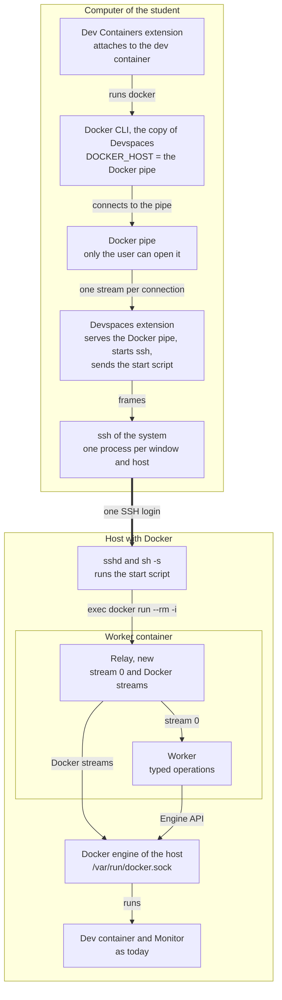

# Remote devspaces with one SSH login

Design proposal of 2026-10-29. Nothing of it is built yet.

Hannes chose this design on 2026-10-29. A VS Code window that uses a remote host opens exactly one SSH login, and that one connection carries the worker and every Docker call of the window. The student needs only VS Code, Devspaces and the SSH client of the system. The host needs Docker and `sh`. Nothing needs admin rights on the student's computer, and nothing needs setup. This is a design: no code is written yet.

## At a glance

Read it from the top: Dev Containers runs `docker`, the CLI connects to the pipe, and Devspaces carries each connection as a stream over the one SSH login. On the host, the relay gives stream 0 to the worker and the Docker streams to the Docker socket.

## What each side needs

The student installs only VS Code and Devspaces. Everything else comes with the system or with Devspaces.

| Where | What | Who brings it | Admin rights |
| --- | --- | --- | --- |
| Computer | VS Code | The student, with the user installer on Windows | No |
| Computer | Devspaces and Dev Containers | VS Code installs Dev Containers together with Devspaces ([package.json L46-L48](https://github.com/nimblescape/nimblescape-devspaces-2/blob/main/package.json#L46-L48)) | No |
| Computer | SSH client `ssh` | Windows 10 and 11, macOS and Linux bring OpenSSH | No |
| Computer | Docker CLI `docker` | Devspaces downloads it (see [The Docker CLI](#the-docker-cli)) | No |
| Host | Docker Engine, rootful or rootless | The person who runs the host, once | Yes, once on the host |
| Host | SSH server, and an account that may use Docker (group `docker`, or rootless Docker) | The person who runs the host, once | Yes, once on the host |
| Host | `sh` | Every Linux system | No |
| Host | Outbound HTTPS for the first build of the helper image | As today | No |

The computer needs no Docker Desktop, no Docker Engine, no WSL, no SSH agent, and no change in `~/.ssh/config`.

## How a window opens

One click on Start or Open runs these steps. Only step 1 is an SSH login.

1. **One login.** Devspaces runs `ssh -T [-p <port>] [-l <user>] -- <host> sh -s`. Without a key, Devspaces asks for the password in VS Code (see [Login without setup](#login-without-setup)).
2. **Start script.** Devspaces writes a fixed script on the standard input of `ssh`, and `sh` on the host runs it. The script checks Docker, builds the helper image when it is missing, and starts the worker container with `docker run --rm -i` (see [The start script](#the-start-script)).
3. **Code.** The pipe loader of the container reads the bundle `dist/helperChannel.js` from standard input and checks its length and its SHA-256 hash, as today ([architecture.md L94](https://github.com/nimblescape/nimblescape-devspaces-2/blob/main/docs/architecture.md?plain=1#L94)). Then it starts the relay.
4. **Relay.** The relay starts the worker as a second process in the same container. From then on, the SSH connection carries frames: the frames of the worker channel and the frames of the Docker streams (see [The relay](#the-relay)).
5. **Docker pipe.** Devspaces opens the Docker pipe of the window on the computer. Each connection to the pipe becomes one Docker stream, and the relay connects it to the Docker socket of the host.
6. **Attach.** The window address names the pipe. Dev Containers runs the Docker CLI that Devspaces downloaded, and every `docker` call of the attach goes through the pipe, without a new login.

Today the code opens about 5 to 6 SSH logins before the worker runs (an SSH check, `docker info`, the check of the helper image, the worker, the engine identity), and the Docker CLI opens one more login for each `docker` call of the attach. With this design, a window opens 1 login per host, whatever the attach does. Each VS Code window has its own extension host, so each window that uses the host has its own login.

## The start script

The start script does in one login what separate SSH calls do today. It is a fixed text in the extension, and it runs these steps in order:

1. It prints a start line with a random value that Devspaces chose for this login. Devspaces ignores everything before that line and writes it to the log, so text that `~/.bashrc` or `~/.profile` prints on the host cannot break the start.
2. `docker info` as JSON: the version of the engine, its identity (ID and root folder), and its security options, which also show a rootless engine. Today these are `docker info`, the Podman check, and the engine identity after the start ([helperChannels.ts L285](https://github.com/nimblescape/nimblescape-devspaces-2/blob/main/src/core/helperChannel/helperChannels.ts#L285)).
3. For a rootless engine, the folder `$XDG_RUNTIME_DIR` of its socket. Today this is a separate SSH call ([dockerHost.ts L313](https://github.com/nimblescape/nimblescape-devspaces-2/blob/main/src/core/docker/dockerHost.ts#L313)).
4. `docker image inspect` of the helper image `devspaces-worker:<hex>`. When the image is missing, `docker build` builds it. The Dockerfile is part of the script text (a here-document). It copies no files, so the build needs no context folder, and it works with BuildKit and with the classic builder ([Dockerfile L7](https://github.com/nimblescape/nimblescape-devspaces-2/blob/main/resources/helper/Dockerfile#L7)). The build output comes back as log lines for the progress notification.
5. `docker ps --all` to find a free worker name, as today ([helperChannels.ts L224](https://github.com/nimblescape/nimblescape-devspaces-2/blob/main/src/core/helperChannel/helperChannels.ts#L224)).
6. `exec docker run --rm -i …` with the same arguments as today ([helperChannels.ts L70-L124](https://github.com/nimblescape/nimblescape-devspaces-2/blob/main/src/core/helperChannel/helperChannels.ts#L70-L124)): no capabilities, no new privileges, only the Docker socket and the two volumes of Devspaces.

The remote command is only `sh -s`, so the login shell of the account (bash, zsh or fish) only starts `sh`. `sh` reads the script from standard input line by line, as POSIX requires, so the `docker run -i` at the end gets the rest of the input unchanged: first the bundle line for the pipe loader, then the frames. Every command before the last one reads its here-document or `/dev/null`, so none of them takes input that belongs to the worker. The values in the script (image tag, names, socket path) are checked with the same patterns as today before they go into the text.

## The relay

The relay keeps the rule "No Docker command and no script crosses the channel" ([security.md L55](https://github.com/nimblescape/nimblescape-devspaces-2/blob/main/docs/security.md?plain=1#L55)). It splits the one SSH connection into the worker channel and the Docker streams, and the Docker streams never reach the worker.

- **Who installs it:** nobody. It is one more entry of the bundle `dist/helperChannel.js`, next to the worker and the batch helper ([main.ts L71-L80](https://github.com/nimblescape/nimblescape-devspaces-2/blob/main/src/helperChannel/main.ts#L71-L80)). The pipe loader checks it like every other entry.
- **Where it runs:** as the first program of the worker container. It starts the worker as a child process from the same stored file, with its own standard input and output. The code of the worker does not change.
- **Frames:** each frame has a type, a stream number, a length, and at most 64 KiB of data (a proposed value). Stream 0 is the worker channel: the JSON lines of today, unchanged. Each Docker stream has an open, data, a close for each direction, and a credit for the flow control. Docker needs the close of one direction for `docker exec` and `docker attach`, when the input ends before the output.
- **Flow control:** each Docker stream may have at most 256 KiB in transit that the other side has not taken (a proposed value). Then it waits. So a large log or a `docker cp` cannot block the worker channel or the other streams.
- **Target:** the relay connects a stream only to the Docker socket of the container (`/var/run/docker.sock`, [names.ts L207](https://github.com/nimblescape/nimblescape-devspaces-2/blob/main/src/core/names.ts#L207)). It cannot open other hosts or ports.
- **Lifetime:** the relay ends when the SSH connection ends, and `--rm` removes the container. When the worker ends by its own rules (after 15 minutes without an operation, [architecture.md L83](https://github.com/nimblescape/nimblescape-devspaces-2/blob/main/docs/architecture.md?plain=1#L83)), the relay keeps the connection while a Docker stream is open, and starts the worker again for the next operation without a new login. Devspaces closes the SSH connection after 10 minutes without an operation and without an open Docker stream.

## Control of the Docker pipe

The Docker pipe gives full control of the Docker engine on the host. These rules limit it to the student and to the window.

| Question | Rule |
| --- | --- |
| Who can connect on Windows | A named pipe `\\.\pipe\devspaces-<random>`. Node.js creates it without its own access list ([libuv pipe.c L596-L600](https://github.com/libuv/libuv/blob/v1.x/src/win/pipe.c#L596-L600)), so it gets the default list of Windows: full control for the user who created it, for administrators and for the system, and only read access for everyone else ([Windows docs](https://github.com/MicrosoftDocs/win32/blob/docs/desktop-src/ipc/named-pipe-security-and-access-rights.md)). Read access is not enough to use the pipe. Not tested yet. |
| Who can connect on macOS and Linux | A Unix socket in a folder that only the user can open (mode 0700). The path must stay below 104 bytes, the limit of macOS. |
| Who uses it | Only Devspaces's own Docker calls in that window, and Dev Containers through `settings.host` of the window address, which Dev Containers 0.470.0 passes on as `DOCKER_HOST`. Nothing global changes: no Docker context, no user setting, no variable outside the window. |
| Name | Random for each devspace window, and kept in the local records of Devspaces: the window address holds the name, and a restored window must open the same name. |
| Another program with the same name | Node.js creates the pipe as its first instance, so the creation fails when another program already serves that name ([libuv pipe.c L826-L843](https://github.com/libuv/libuv/blob/v1.x/src/win/pipe.c#L826-L843)). Devspaces then opens the window again with a new random name, so the window never uses the pipe of the other program. This depends on the order at the start of a window (see [Risks and checks](#risks-and-checks)). |
| What passes | Devspaces sees the method and path of every Docker API request. The first version only logs them. A later version can refuse the requests that Dev Containers does not need, after a measurement of what it needs. This protects against other programs on the computer, not against the student, who has full Docker access through SSH anyway. |
| How long it lives | It closes with the window or with the SSH connection. |
| Log | The Devspaces log has one line per request: the method and the path, never a body. |

## Login without setup

Devspaces keeps the `ssh` of the system, so `~/.ssh/config`, `ProxyJump` and existing keys work as before. Three changes make the first login work without any setup:

- **Password.** For this one login, Devspaces sets `SSH_ASKPASS` to a small script and `SSH_ASKPASS_REQUIRE=force`, and leaves out `BatchMode=yes` ([dockerHost.ts L305](https://github.com/nimblescape/nimblescape-devspaces-2/blob/main/src/core/docker/dockerHost.ts#L305)). The script runs the Node.js of VS Code and asks for the password in a VS Code input box. Every other question of `ssh`, for example a one-time code, appears the same way. Dev Containers 0.470.0 does the same for its own SSH logins (`scripts/ssh-askpass.bat` on Windows, `scripts/ssh-askpass.sh` elsewhere).
- **Host key.** For an unknown host, `ssh` asks through the same script. Devspaces shows the host and the fingerprint of its key, and the student confirms it once. `ssh` then stores it in `~/.ssh/known_hosts`. A changed host key still fails, because `ssh` refuses it. Today Devspaces never accepts a host key ([guide.md L311](https://github.com/nimblescape/nimblescape-devspaces-2/blob/main/docs/guide.md?plain=1#L311)), so this changes a rule (see [Decisions for Hannes](#decisions-for-hannes)).
- **Key offer.** Right after a password, Devspaces asks "Log in without a password next time?". On yes, it creates an Ed25519 key pair with `ssh-keygen` in `~/.ssh`, without a passphrase, so no SSH agent is needed. The start script of the same login adds the public key to `~/.ssh/authorized_keys` on the host before it starts the worker, so no second login is needed. Later logins give the key to `ssh` with `-i` on Devspaces's own command line.

## The Docker CLI

Dev Containers needs a `docker` program on the computer for the attach, and Devspaces brings it without an installation. The attach needs neither Buildx nor Compose.

- **Source:** the static builds of Docker Inc. at `download.docker.com/{win,mac,linux}/static/stable/<arch>/`. Builds exist for Windows x86\_64, macOS x86\_64 and aarch64, and Linux.
- **Check:** the site has no checksum files, so Devspaces pins the version and the SHA-256 of each file in its code, and checks the download before it uses it.
- **Size:** on Windows, the zip of version 29.9.2 has about 50 MB. It also holds `dockerd.exe`; Devspaces keeps only `docker.exe` (45 MB).
- **Place:** the global storage folder of Devspaces, which belongs to the user. A new CLI version comes with a new Devspaces version.
- **Use:** Devspaces puts that folder at the front of `PATH` of the extension host, only in a window that uses a remote host, so Dev Containers in that window finds it. Today Devspaces changes `PATH` only on Windows, for the folders of Docker Desktop ([dockerCli.ts L198-L208](https://github.com/nimblescape/nimblescape-devspaces-2/blob/main/src/core/docker/dockerCli.ts#L198-L208)). Devspaces uses its copy for remote hosts also when another Docker CLI is installed, so every computer runs the same tested version.
- **Windows on Arm:** there is only an x86\_64 build. Windows 11 on Arm runs it in emulation (to test).

## Remote hosts without Docker contexts

Devspaces keeps its own list of SSH hosts and no longer uses Docker contexts for them.

- The list holds user, host and port, or an alias of `~/.ssh/config`, in the local records of Devspaces. Each remote devspace names its host.
- "Use a Remote Docker Host…" adds a host to that list. It no longer creates a Docker context and no longer switches the global context ([remoteDockerCommands.ts](https://github.com/nimblescape/nimblescape-devspaces-2/blob/main/src/vscode/remoteDockerCommands.ts)), so the student's own `docker` command keeps its target.
- A window knows its host from its devspace, so the question "Use \<host> again?" at the start of a restored window ([controller.ts L3932-L3956](https://github.com/nimblescape/nimblescape-devspaces-2/blob/main/src/vscode/controller.ts#L3932-L3956)) is no longer needed.
- A Docker context with an `ssh://` endpoint, or `DOCKER_HOST=ssh://…`, that the user made is offered once as a host for the list.
- The local Docker engine works as today. `tcp://` endpoints stay unsupported ([dockerHost.ts L89-L107](https://github.com/nimblescape/nimblescape-devspaces-2/blob/main/src/core/docker/dockerHost.ts#L89-L107)).
- When no Docker is found, the sidebar offers "Use a remote host (SSH)" next to the Docker installation ([dockerSetup.ts L553-L555](https://github.com/nimblescape/nimblescape-devspaces-2/blob/main/src/core/docker/dockerSetup.ts#L553-L555)), so a student without Docker starts there.

## Windows without a remote host: an own WSL distribution

Hannes chose this on 2026-10-29 as the way to work on Windows, with the Docker pipe. The same design works on the Windows computer of the student when Devspaces brings its own WSL distribution with Docker Engine inside. Only the transport changes: `wsl.exe -d devspaces -u root -- sh -s` takes the place of `ssh … sh -s`. There is no login, no password and no key. Docker Desktop is not needed, and other distributions stay as they are.

### One click, step by step

1. **Offer.** When no Docker and no remote host is found, the sidebar offers "Set up Docker for Devspaces". One question shows the download size and the folder.
2. **WSL.** `wsl.exe --version` shows whether WSL is installed. When it is missing, this is the only step that needs admin rights, and Windows must restart ([install.md L20](https://github.com/MicrosoftDocs/WSL/blob/main/WSL/install.md?plain=1#L20)). Devspaces can start `wsl --install --no-distribution` ([basic-commands.md L31](https://github.com/MicrosoftDocs/WSL/blob/main/WSL/basic-commands.md?plain=1#L31)), and Windows asks for an administrator. A student without admin rights gets a message for the IT staff.
3. **Download.** Devspaces downloads the Debian or Ubuntu `.wsl` file from the list that WSL itself uses. The list gives a URL and a SHA-256 for each file ([DistributionInfo.json](https://github.com/microsoft/WSL/blob/master/distributions/DistributionInfo.json)), and Devspaces checks the hash.
4. **Register.** `wsl --install --from-file <file> --name devspaces --location <folder of Devspaces>` registers the distribution for this Windows user ([build-custom-distro.md L195](https://github.com/MicrosoftDocs/WSL/blob/main/WSL/build-custom-distro.md?plain=1#L195), [basic-commands.md L25](https://github.com/MicrosoftDocs/WSL/blob/main/WSL/basic-commands.md?plain=1#L25)). The WSL docs name no admin step for this; to test.
5. **Docker inside.** The first start script runs as root in the new distribution. It turns on systemd in `/etc/wsl.conf` ([wsl-config.md L50-L54](https://github.com/MicrosoftDocs/WSL/blob/main/WSL/wsl-config.md?plain=1#L50-L54)), installs Docker Engine from download.docker.com, and writes the Docker settings. Devspaces then restarts the distribution once (`wsl --terminate devspaces`).
6. **Use.** From then on, every window works as with a remote host: the start script, the relay, the Docker pipe and the downloaded Docker CLI.

### What is separate and what is shared

- **Separate:** the file system (one virtual disk in the folder of Devspaces), the processes, `dockerd`, the images and the volumes. Other distributions see none of it and need no Docker.
- **Shared by all distributions:** the Linux kernel, the memory of the WSL VM (by default 50% of the computer's memory, [wsl-config.md L237](https://github.com/MicrosoftDocs/WSL/blob/main/WSL/wsl-config.md?plain=1#L237)), and the network stack ([about.md L43](https://github.com/MicrosoftDocs/WSL/blob/main/WSL/about.md?plain=1#L43)).

### Lifetime and care

- **Lifetime:** the connection of a devspace window keeps the distribution running. From the first use of Devspaces in a VS Code session, Devspaces also holds one small idle `wsl.exe` session open, so the distribution runs while VS Code runs. After VS Code closes, the existing choices decide ([guide.md L263-L268](https://github.com/nimblescape/nimblescape-devspaces-2/blob/main/docs/guide.md?plain=1#L263-L268), [L160](https://github.com/nimblescape/nimblescape-devspaces-2/blob/main/docs/guide.md?plain=1#L160), [L225](https://github.com/nimblescape/nimblescape-devspaces-2/blob/main/docs/guide.md?plain=1#L225)):
  - **The Monitor of this engine has the answer Keep Running, or a devspace keeps running when closed** (Keep Running When Closed, or `devspaces.stopOnClose` off): a start entry of the Windows user, with no admin rights needed, starts a small keeper at logon. The keeper holds a `wsl.exe` session while the Monitor or a kept devspace runs, and ends itself when nothing needs WSL, for example after the Monitor's 30 days without use. The Monitor question is the consent, and its text says that WSL starts at logon. When the answer changes and no devspace is kept, Devspaces removes the start entry.
  - **Otherwise** there is no start entry. The distribution stops 15 seconds after VS Code closes, together with Docker and the containers. Devspaces also lets go of its idle session when no devspace runs and the Monitor has ended. A missed background run runs once when the Monitor runs again, as today ([guide.md L253](https://github.com/nimblescape/nimblescape-devspaces-2/blob/main/docs/guide.md?plain=1#L253)).
  - To test: the start entry starts `wsl.exe` without a visible console window.
- **Updates:** Devspaces becomes the administrator of this Linux. It runs `apt-get update` and `apt-get upgrade` in the distribution, for example once a week through the start script, and writes the result to the log.
- **Disk:** the virtual disk grows with images and volumes. The image cleanup of Devspaces works as on any engine.
- **Removal:** a command removes the distribution with `wsl --unregister devspaces` after a question, because this deletes all devspaces in it and their data ([basic-commands.md L214](https://github.com/MicrosoftDocs/WSL/blob/main/WSL/basic-commands.md?plain=1#L214)).

### Risks of this variant

- **Docker Desktop on the same computer:** Docker warns that Docker Desktop and a Docker Engine in a WSL distribution can conflict ([Docker docs L35-L36](https://github.com/docker/docs/blob/main/content/manuals/desktop/features/wsl/_index.md?plain=1#L35-L36)). Our distribution stays out of the WSL integration of Docker Desktop and is never the default distribution; Devspaces checks both. The two engines would still share one network stack (the bridge `docker0` and the firewall rules). So our engine runs rootless, which gives it its own network, or rootful in its own network namespace. A test with Docker Desktop installed decides whether Devspaces always uses its own distribution, or uses Docker Desktop when it is there.
- **First-start question:** the Debian and Ubuntu files ask for a user name at the first interactive start ([build-custom-distro.md L64](https://github.com/MicrosoftDocs/WSL/blob/main/WSL/build-custom-distro.md?plain=1#L64)). Devspaces starts only as root and without a terminal; whether the question stays away must be tested.
- **WSL itself:** on school computers, the IT staff must install WSL once (step 2).

### Open choices of this variant

| Choice | Recommended | Other choice |
| --- | --- | --- |
| Base of the distribution | The Debian file from the WSL list, with Docker installed at setup: no image of our own to publish and update | An own image, built in CI from `debian:trixie` with Docker inside: no first-start question, but one more thing to publish |
| Next to Docker Desktop | Always our own distribution, kept apart from Docker Desktop (rootless engine), if the test passes: every student gets the same engine | Use Docker Desktop when it is installed |

## A remote host for many students

The management of a remote host for many students is in its own doc, [Remote host for many students](remote-host-for-many-students.md): how the students share RAM and disk, the onboarding through a management page, the service on the host, the life of each Linux user and the isolation between students.

## What changes in the code

The worker, the Monitor, the pipeline and the local Docker stay as they are. The changes are in the connection to a remote host.

| Part | Files | Change |
| --- | --- | --- |
| One login and the start script | [helperChannels.ts](https://github.com/nimblescape/nimblescape-devspaces-2/blob/main/src/core/helperChannel/helperChannels.ts), [bootstrapDocker.ts](https://github.com/nimblescape/nimblescape-devspaces-2/blob/main/src/core/docker/bootstrapDocker.ts), [remoteDocker.ts](https://github.com/nimblescape/nimblescape-devspaces-2/blob/main/src/core/docker/remoteDocker.ts) | The SSH check, `docker info`, the image check and build, and the worker start become the start script. |
| Relay | [main.ts](https://github.com/nimblescape/nimblescape-devspaces-2/blob/main/src/helperChannel/main.ts), new `relay.ts` | New entry: frames, streams, flow control. |
| Channel transport | [helperChannel.ts](https://github.com/nimblescape/nimblescape-devspaces-2/blob/main/src/core/helperChannel/helperChannel.ts) | Stream 0 of the frames instead of the raw input and output of `docker run`. |
| Docker pipe | New module in `src/vscode/` | Named pipe or Unix socket, one stream per connection, log of the requests. |
| Window address | [authority.ts](https://github.com/nimblescape/nimblescape-devspaces-2/blob/main/src/vscode/connection/authority.ts), [controller.ts](https://github.com/nimblescape/nimblescape-devspaces-2/blob/main/src/vscode/controller.ts#L4004-L4035) (`windowArgs`) | `settings.host` with the pipe instead of `settings.context`. |
| Hosts list | [dockerTargets.ts](https://github.com/nimblescape/nimblescape-devspaces-2/blob/main/src/core/docker/dockerTargets.ts), [remoteDockerCommands.ts](https://github.com/nimblescape/nimblescape-devspaces-2/blob/main/src/vscode/remoteDockerCommands.ts) | Own records instead of Docker contexts, no global switch. |
| Other Docker calls of the extension | [bootstrapDocker.ts](https://github.com/nimblescape/nimblescape-devspaces-2/blob/main/src/core/docker/bootstrapDocker.ts) | For a remote host, through the pipe of the window (`DOCKER_HOST`) instead of `DOCKER_CONTEXT`: the attach diagnostics, the image cleanup, and the removal from an engine. |
| Docker CLI | [dockerCli.ts](https://github.com/nimblescape/nimblescape-devspaces-2/blob/main/src/core/docker/dockerCli.ts), new download module | Download, check, `PATH` in remote windows. |
| Login | [dockerHost.ts](https://github.com/nimblescape/nimblescape-devspaces-2/blob/main/src/core/docker/dockerHost.ts#L299-L310) (`sshCommandArgs`), new askpass script | Password, host key, key offer. |
| Setup view | [dockerSetup.ts](https://github.com/nimblescape/nimblescape-devspaces-2/blob/main/src/core/docker/dockerSetup.ts) | "Use a remote host (SSH)" without Docker. |
| Docs | [architecture.md](https://github.com/nimblescape/nimblescape-devspaces-2/blob/main/docs/architecture.md), [security.md](https://github.com/nimblescape/nimblescape-devspaces-2/blob/main/docs/security.md), [guide.md](https://github.com/nimblescape/nimblescape-devspaces-2/blob/main/docs/guide.md), [README.md](https://github.com/nimblescape/nimblescape-devspaces-2/blob/main/README.md) | The relay, the pipe, a new row in the trust boundaries, the login; the behaviors at the top of the README name the pipe and the key. |
| Tests | CI job "vscode attach remote" ([ci.yml L393-L461](https://github.com/nimblescape/nimblescape-devspaces-2/blob/main/.github/workflows/ci.yml#L393-L461)) | The test host gets an account with a password and one with a key; the test counts the logins of one open. |

## Risks and checks

- **Order at the start of a window.** The pipe must exist before Dev Containers runs its first `docker` call. Devspaces activates on `onResolveRemoteAuthority:attached-container` ([package.json L51](https://github.com/nimblescape/nimblescape-devspaces-2/blob/main/package.json#L51)), and the code already assumes that VS Code waits for `activate()` before it resolves the window address ([controller.ts L3937](https://github.com/nimblescape/nimblescape-devspaces-2/blob/main/src/vscode/controller.ts#L3937)). The first prototype checks this.
- **One connection for everything.** When the SSH connection or the worker container ends (a network change, sleep of the laptop, `docker rm -f`, a restart of the engine), the window loses Docker. Devspaces then opens a new login and serves the same pipe name again, and Dev Containers connects again. How Dev Containers behaves in that gap needs a test. `ServerAliveInterval` keeps an idle connection open through routers.
- **SSH on Windows.** The built-in OpenSSH differs between Windows versions. The password prompt through `SSH_ASKPASS` must be tested on Windows 10 and on Windows 11. Dev Containers uses the same way, which lowers this risk.
- **Throughput.** All traffic shares one TCP connection. A large `docker cp` slows the other streams; the flow control keeps them working.
- **Hosts with a fixed command.** An account with `ForceCommand` or a restricted shell cannot run `sh -s`. Such hosts are not supported, and the message says so.
- **Named pipe from other computers.** Windows lets other computers open a named pipe over the network when their account has access to it (libuv does not set `PIPE_REJECT_REMOTE_CLIENTS`). Only the same user, administrators and the system have that access, as above.
- **Measure.** The logins and the time of one open are measured today and with the prototype, in the CI job "vscode attach remote".

## Decisions for Hannes

These five choices are open. The design above uses the recommended one of each.

| Decision | Recommended | Other choice |
| --- | --- | --- |
| Docker contexts for remote hosts | Replace them with Devspaces's own list of hosts: one way to build and test, and no global switch | Keep both ways |
| Unknown host key | Devspaces shows the fingerprint and the student confirms it once, as VS Code Remote-SSH does | The student accepts it in a terminal first (today's rule, a setup step) |
| SSH key | Offer a key without passphrase after a password login: no SSH agent needed, and only the user can read the key file | Never create keys; the student types the password at each login |
| Docker CLI | Always the copy of Devspaces for remote hosts: one tested version | An installed Docker CLI first, the copy only when none is found |
| Filter on the pipe | Only log the requests in the first version | Refuse unknown requests from the start |

## Plan

Nine pull requests, in this order. Hannes agreed to this plan on 2026-10-29 and chose the order: the remote host over SSH first, then the own WSL distribution.

1. **Measure today** (test only). The CI job "vscode attach remote" counts the SSH logins and the time of one open. This gives the number to compare with.
2. **Relay and frames.** The new entry, the frames and the flow control, and their partner in the extension, with unit tests. Nothing uses them yet.
3. **One connection.** `ssh -T -- <host> sh -s` with the start script starts the worker behind the relay, and the worker channel runs on stream 0. The transport is one small part, so that step 8 can add `wsl.exe`.
4. **Docker pipe.** One pipe per window, `settings.host` in the window address, and the other Docker calls of the extension through the pipe. The CI job shows 1 login per open. Dev Containers 0.470.0 turns `settings.host` into `DOCKER_HOST` (checked in its code).
5. **Docker CLI download.** Pinned version and SHA-256, PATH only in remote windows.
6. **Hosts list.** Devspaces's own list of SSH hosts, no global context switch, existing `ssh://` contexts offered once.
7. **Login without setup.** Password, host key and the key offer, tested on Windows 10, Windows 11, macOS and Linux.
8. **Own WSL distribution.** The setup (download, register, Docker Engine inside) and the transport `wsl.exe -d devspaces -u root -- sh -s`.
9. **WSL lifetime.** The idle session, and the start entry and the keeper after the existing Monitor settings.

Each pull request updates architecture.md and security.md for its part, and the guide and the behaviors at the top of the README when users see a change. Each one gets review rounds until no serious finding is left, and is merged when CI is green. Nothing is published until Hannes says so. The five decisions above use the recommended choice unless Hannes says otherwise.
