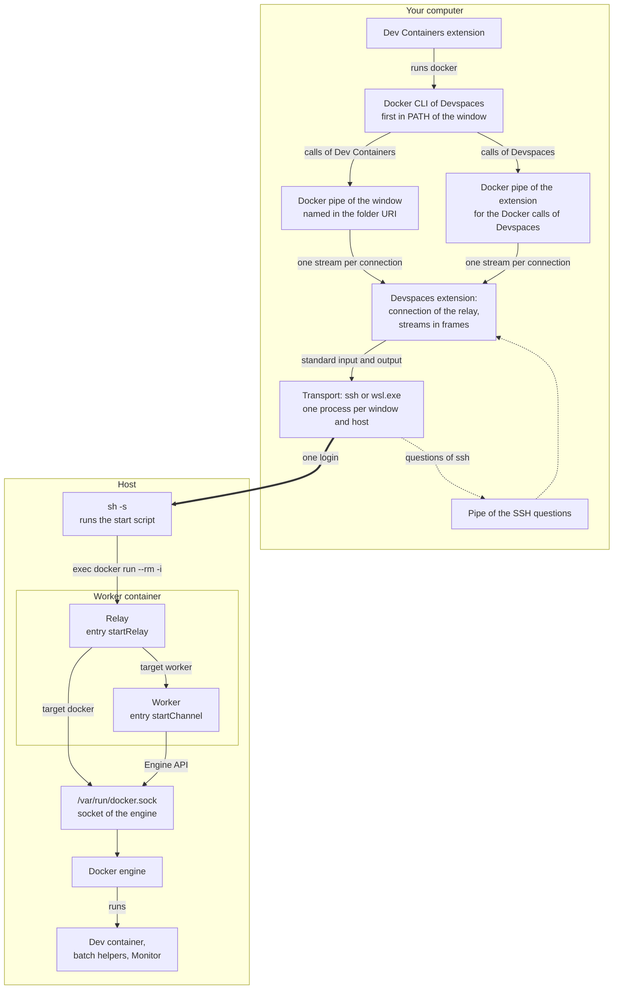
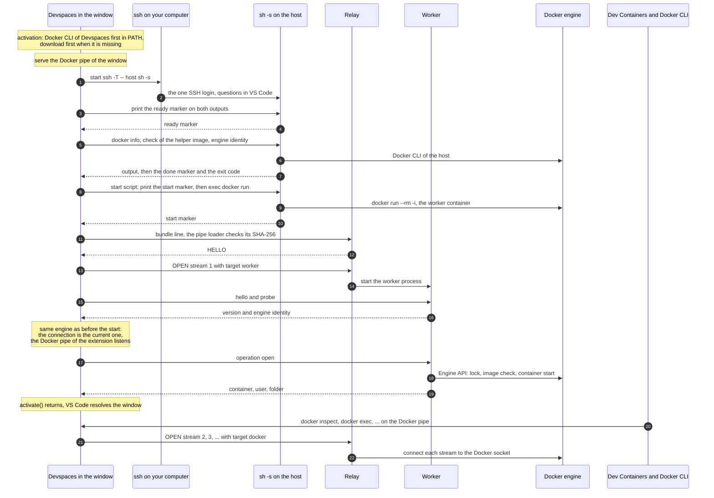
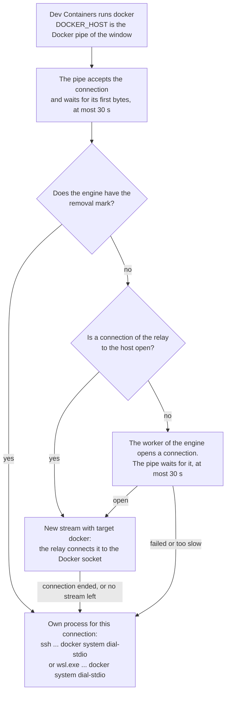
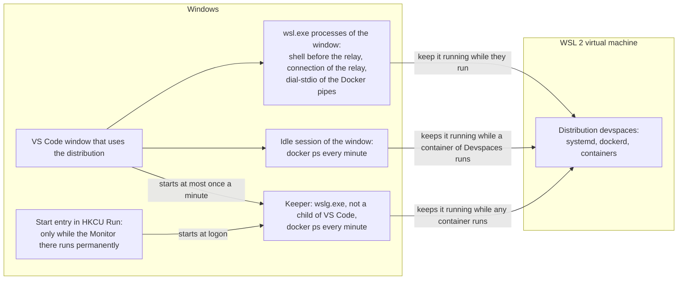

# How the remote connection works

This document explains how Devspaces works with a Docker engine that is not the Docker of your computer, and how the VS Code window of a devspace there connects to its container. There are two such engines:

- a **remote host**: Docker Engine on another computer, reached over SSH;
- the **WSL distribution of Devspaces** on Windows: Docker Engine in the WSL distribution `devspaces`, reached with `wsl.exe`.

The document describes the code on `main` and shows how its parts work together. Each part has its complete rules in [architecture.md](architecture.md), and the sections here link to them. The view of the user is in [guide.md](guide.md#remote-docker-host), the security view in [security.md](security.md#remote-and-shared-engines). The design proposal that the code follows is [design/remote-devspaces-one-ssh-login.md](design/remote-devspaces-one-ssh-login.md); [Where the code differs from the design](#where-the-code-differs-from-the-design) lists the differences.

Links to source files point to the branch `main` of the repository.

**Contents:** [The goal](#the-goal) · [Words in this document](#words-in-this-document) · [The parts at a glance](#the-parts-at-a-glance) · [SSH host and WSL distribution](#ssh-host-and-wsl-distribution) · [How a window of a remote devspace opens](#how-a-window-of-a-remote-devspace-opens) · [The list of hosts](#the-list-of-hosts) · [The transport](#the-transport) · [The shell before the relay](#the-shell-before-the-relay) · [The start script](#the-start-script) · [The relay](#the-relay) · [One connection per window and host](#one-connection-per-window-and-host) · [The Docker pipes](#the-docker-pipes) · [The Docker CLI of Devspaces](#the-docker-cli-of-devspaces) · [The attach of the Dev Containers extension](#the-attach-of-the-dev-containers-extension) · [SSH logins without setup](#ssh-logins-without-setup) · [The WSL distribution of Devspaces](#the-wsl-distribution-of-devspaces) · [Logins of a window](#logins-of-a-window) · [Time limits](#time-limits) · [When a part fails](#when-a-part-fails) · [Not implemented](#not-implemented) · [Where the code differs from the design](#where-the-code-differs-from-the-design) · [Tests](#tests) · [Source files](#source-files)

## The goal

One VS Code window logs in to a remote host once (more exactly: once for each extension host, see [Logins of a window](#logins-of-a-window)). That one login carries:

- the **worker channel**: the typed operations between the extension and its worker container on the host (open, stop, refresh, and the others);
- every **Docker call of the Dev Containers extension** for the window of a devspace on that host;
- the **Docker calls of Devspaces itself** while that connection is open.

Without the relay, the Docker CLI starts a new SSH login (`ssh … docker system dial-stdio`) for each Docker call of the Dev Containers extension. An SSH server limits new logins (`MaxStartups`, and in OpenSSH 9.8 and later `PerSourcePenalties`), and each login takes time.

What each side needs:

| Where | What | Notes |
| --- | --- | --- |
| Your computer | VS Code, Devspaces, the Dev Containers extension | VS Code installs Dev Containers together with Devspaces ([`package.json`](https://github.com/nimblescape/nimblescape-devspaces-2/blob/main/package.json), `extensionDependencies`). |
| Your computer | The OpenSSH client `ssh` | Windows 10 and 11, macOS, and Linux bring it. Only for SSH hosts. |
| Your computer | A Docker CLI | Not needed: Devspaces downloads its own, see [The Docker CLI of Devspaces](#the-docker-cli-of-devspaces). |
| Remote host | Docker Engine, rootful or rootless, with its Docker CLI | Set up once by the person who runs the host. Devspaces never installs or starts Docker on a remote host. |
| Remote host | An SSH server and an account that may use Docker | The group `docker`, or rootless Docker. |
| Remote host | `sh` | Every Linux system has it. |
| Windows without a remote host | WSL 2.4.4 or later | Devspaces sets up the distribution `devspaces` with Docker Engine itself, without administrator rights. Only the installation of WSL itself needs them. |

Nothing needs setup on your computer: when an SSH login asks for a password or an unknown host key, Devspaces asks in VS Code (see [SSH logins without setup](#ssh-logins-without-setup)).

## Words in this document

| Word | Meaning |
| --- | --- |
| Docker host of Devspaces | The Docker engine that Devspaces uses in all its windows on this computer: the local Docker, or one host of its own list. |
| Host of the list | One entry of the own list of Devspaces: an alias of the SSH config, an SSH address `user@host[:port]`, or `wsl:devspaces` for the WSL distribution of Devspaces. |
| Transport | The program on this computer whose standard input and output reach `sh` on the host: `ssh … sh -s`, or `wsl.exe … sh -s`. |
| Shell before the relay | One login of the transport on which the extension runs the checks that only read, before the relay starts. The relay then takes this login over. |
| Worker | The helper container of one window on one Docker engine. It runs the operations of the window over the Docker Engine API. |
| Relay | The first program of the worker container on a remote engine. It splits one connection into streams. |
| Connection of the relay | One login of the transport that runs the relay. It carries frames in both directions. |
| Stream | A channel of bytes in both directions inside a connection of the relay: to the worker, or to the Docker socket. |
| Docker pipe of the window | A Unix socket (macOS, Linux) or a named pipe (Windows) on this computer. The folder URI of the window of a devspace names it, and the Dev Containers extension uses it as `DOCKER_HOST`. |
| Docker pipe of the extension | One more such pipe for each host. Only the Docker calls of Devspaces itself use it. |
| Docker CLI of Devspaces | The `docker` program of one fixed version that Devspaces downloads and checks against a size and a SHA-256 hash in its code. |
| Engine identity | The ID and the root folder of a Docker engine (`docker info --format '{{json .ID}} {{json .DockerRootDir}}'`). Devspaces compares it to know that two calls reach the same engine. |

## The parts at a glance



The host is another computer, or the WSL distribution `devspaces`. Read the diagram from the top:

1. The Dev Containers extension runs `docker` for the window. `PATH` of the window starts with the folder of the Docker CLI of Devspaces, so that CLI runs. Its `DOCKER_HOST` is the Docker pipe of the window.
2. The Devspaces extension serves that pipe. Each connection to the pipe becomes one stream on the connection of the relay. The Docker calls of Devspaces itself go the same way through the Docker pipe of the extension.
3. The connection of the relay is the standard input and output of one transport process: `ssh -T -- <host> sh -s` for a remote host, `wsl.exe -d devspaces -u root --cd / --exec sh -s` for the WSL distribution. A question of an SSH login goes from `ssh` through `SSH_ASKPASS` to the pipe of the SSH questions, and Devspaces shows it in VS Code.
4. On the host, `sh -s` runs the start script, which replaces the shell with `docker run --rm -i … startRelay`. From then on, the bytes of the transport are the standard input and output of the relay.
5. The relay starts the worker as a process in the same container and gives it the stream with the target `worker`. It connects each stream with the target `docker` to the Docker socket of the container, which is the socket of the engine (a bind mount).

The relay never gives a Docker stream to the worker, and the worker gets no Docker command over its channel: the rule of [security.md](security.md#trust-boundaries) stays true.

## SSH host and WSL distribution

Both kinds of hosts use the same relay, the same shell before the relay, the same Docker pipes, and the same Docker CLI of Devspaces. Only the transport and a few rules differ.

| | SSH host | WSL distribution of Devspaces |
| --- | --- | --- |
| Name in the list | An alias of the SSH config, or `user@host[:port]` | `wsl:devspaces` |
| Endpoint of its target | `ssh://<host>` | `wsl://devspaces` (only a name for the log; it is no endpoint of the Docker CLI) |
| Transport | `ssh -o BatchMode=yes -o ConnectTimeout=15 -T [-i key] [-p port] [-l user] -- <host> sh -s` | `wsl.exe -d devspaces -u root --cd / --exec sh -s`, with `WSL_UTF8=1` |
| Login | SSH, with the keys of `ssh` or the key of Devspaces; questions only in a flow of the user | None: the Windows user owns the distribution, and the commands run as root of the distribution |
| Docker calls of Devspaces | Through the Docker pipe of the extension while a connection of the relay is open; else a call that only reads runs on the shell before the relay, and any other call uses `ssh://<host>` | Always through the Docker pipe of the extension; each connection runs its own `wsl.exe … docker system dial-stdio` |
| Who installs Docker | The person who runs the host | Devspaces, with **Set Up Docker for Devspaces in WSL…** |
| Lifetime | The host runs by itself | By default, WSL stops the distribution 15 seconds after the last `wsl.exe` for it ended; Devspaces keeps it running while it is needed (see [Start and stop of the distribution](#start-and-stop-of-the-distribution)) |
| Code | [`sshHostTransport`](https://github.com/nimblescape/nimblescape-devspaces-2/blob/main/src/core/relay/transport.ts) | [`wslHostTransport`](https://github.com/nimblescape/nimblescape-devspaces-2/blob/main/src/core/relay/transport.ts) |

`hostAccessOf` in [`src/core/docker/dockerHost.ts`](https://github.com/nimblescape/nimblescape-devspaces-2/blob/main/src/core/docker/dockerHost.ts) decides the kind: `wsl:<name>` is a WSL distribution, unless the text is an SSH address (`wsl:2222` is the SSH host `wsl` with the port 2222).

## How a window of a remote devspace opens

This is the case that the CI job "vscode attach remote" measures: VS Code restores the window of a devspace on an SSH host, or **Open Recent** opens it. The window logs in to the host once.



The steps in words:

1. **Docker CLI.** While the window activates, the extension puts the folder of the Docker CLI of Devspaces first in `PATH` of its extension host. When the CLI is not there yet, the window downloads it first, with a progress notification ([`src/vscode/ownDockerCliWindow.ts`](https://github.com/nimblescape/nimblescape-devspaces-2/blob/main/src/vscode/ownDockerCliWindow.ts)).
2. **Docker pipe of the window.** The folder URI of the window names the address of its Docker pipe (`settings.host`). The window serves that address before `activate()` returns, but only when it is the address that this computer makes for the devspace of the window ([`serveWindowPipe`](https://github.com/nimblescape/nimblescape-devspaces-2/blob/main/src/core/relay/windowPipe.ts)). Otherwise the window closes its remote connection with a message.
3. **Open flow.** The window runs the open flow of its devspace on the Docker host of the devspace, whatever host Devspaces uses now ([`Controller.withHostOf`](https://github.com/nimblescape/nimblescape-devspaces-2/blob/main/src/vscode/controller.ts)). The flow has a progress notification, so its SSH login may ask questions in VS Code.
4. **Shell before the relay.** The SSH check of the host is the login of the shell before the relay. The checks that only read run on that shell as one command line each: `docker info`, the check of the helper image, the engine identity, and for a rootless engine the folder `$XDG_RUNTIME_DIR` of its socket ([`src/core/relay/remoteShell.ts`](https://github.com/nimblescape/nimblescape-devspaces-2/blob/main/src/core/relay/remoteShell.ts)).
5. **Start of the relay.** The connection of the relay takes the login of the shell over and writes the start script into the idle shell ([`openRelayConnection`](https://github.com/nimblescape/nimblescape-devspaces-2/blob/main/src/core/relay/transport.ts)). The script starts the worker container with `docker run --rm -i`. Its pipe loader reads the bundle from the first line of its input, checks its SHA-256 hash against the hash on the command line, and starts the relay.
6. **Worker.** The extension opens the stream with the target `worker`. The relay starts the worker. The extension sends `hello` and `probe`, and compares the engine identity of the worker with the identity that it read before the start. Only when they match, the connection becomes the current connection of the host, and the Docker pipe of the extension for the host starts to listen.
7. **Operation.** The worker runs the operation `open` (see [architecture.md, Open](architecture.md#open)): it starts the container, or builds and creates it when needed, and returns the container, the remote user, and the folder.
8. **Attach.** `activate()` returns, and VS Code lets the Dev Containers extension resolve the window. Its Docker calls go to the Docker pipe of the window. Each connection to the pipe becomes one stream with the target `docker` on the same connection of the relay. No new login is needed.

**Start from the sidebar.** A **Start** runs steps 3 to 7 in the window where you clicked it, as a flow with its progress notification. Then the extension opens the folder URI of the devspace. VS Code starts a new extension host for that window, also when the same window is used. The new extension host has no connection yet. It opens one when it first needs the host, for example for the first connection of its Docker pipe, with one more login. This login is not part of a flow of the user, so it asks nothing (see [SSH logins without setup](#ssh-logins-without-setup)).

**A devspace on the local Docker** has no Docker pipe and no relay. Its window URI names no Docker host, its worker starts with the Docker CLI of this computer, and the Dev Containers extension uses the current Docker context.

## The list of hosts

Devspaces keeps its own list of hosts in `remote-docker.json` of its global storage ([`src/core/storage/remoteDockerState.ts`](https://github.com/nimblescape/nimblescape-devspaces-2/blob/main/src/core/storage/remoteDockerState.ts)). It never creates, changes, or uses a Docker context for a host of its list. It sets no `DOCKER_HOST` of your environment and writes no setting of the Dev Containers extension. So the `docker` command in your terminals keeps its target.

The file holds:

- `remoteHosts`: the hosts of the list, in the order in which they were added;
- `dockerHost`: the Docker host of Devspaces, one host of the list; absent for the local Docker;
- `hosts`: for each host, the socket of a rootless engine there (`rootlessSocket`), and the state of the key of Devspaces (`sshKey`: `installed` or `declined`);
- `offered`: the SSH hosts of Docker contexts that Devspaces offered once for its list.

Each change of the file runs under the lock folder `remote-docker.lock`, because every window of this computer changes it.

The commands ([`src/vscode/remoteDockerCommands.ts`](https://github.com/nimblescape/nimblescape-devspaces-2/blob/main/src/vscode/remoteDockerCommands.ts)):

- **Use a Remote Docker Host…** lists the hosts of the list, the other hosts of the SSH config, the SSH hosts of the Docker contexts of the user, and on Windows `wsl:devspaces` when WSL lists that distribution. It also takes a typed SSH address. It tests the host with a new login and `docker info` on it, and then makes it the Docker host of Devspaces. On a computer without a Docker CLI, it downloads the Docker CLI of Devspaces first.
- **Use the Local Docker** goes back to the Docker of this computer and keeps the list.
- **Choose the Docker Host…** (the first row of the sidebar) offers both in one list.
- **Remove a Host from the List…** forgets a host. Its devspaces stay on that computer.

An operation reads the Docker host of Devspaces once, at its start (`DockerTargets.resolve` in [`src/core/docker/dockerTargets.ts`](https://github.com/nimblescape/nimblescape-devspaces-2/blob/main/src/core/docker/dockerTargets.ts)). Every Docker call of that operation runs on that host, so a change of the host in another window cannot move the operation to another engine. The window of a devspace always uses the host of its devspace. More rules: [architecture.md, Remote Docker hosts](architecture.md#remote-docker-hosts).

## The transport

The transport is one process on this computer ([`src/core/relay/transport.ts`](https://github.com/nimblescape/nimblescape-devspaces-2/blob/main/src/core/relay/transport.ts), `sshCommandArgs` and `wslCommandArgs` in [`src/core/docker/dockerHost.ts`](https://github.com/nimblescape/nimblescape-devspaces-2/blob/main/src/core/docker/dockerHost.ts)). Its standard input and output are bytes.

**SSH:**

```text
ssh -o BatchMode=yes -o ConnectTimeout=15 -T [-i ~/.ssh/devspaces_ed25519] [-p <port>] [-l <user>] -- <host> sh -s
```

- `-T`: no terminal. `--`: the host can never be read as an option.
- The remote command is only `sh -s`. So the login shell of the account (bash, zsh, fish) only starts `sh`, and `sh` reads its commands from the standard input.
- `-i` only for a host whose record says `sshKey: "installed"`, while the key file exists.
- A login of a flow of the user has `-x` in place of `-o BatchMode=yes`, and the environment of the questions in VS Code (see [SSH logins without setup](#ssh-logins-without-setup)). Every other login has `BatchMode=yes` and `SSH_ASKPASS_REQUIRE=never`.
- `ssh` reads the SSH config of the user as always, so `ProxyJump`, `IdentityFile`, and `ControlMaster` of the SSH config work.

**WSL:**

```text
wsl.exe -d devspaces -u root --cd / --exec sh -s
```

- `--exec` runs `sh` without the login shell of the distribution. `--cd /` starts it in the root folder of the distribution, not in the Windows folder of VS Code.
- `WSL_UTF8=1` makes the messages of `wsl.exe` itself UTF-8. An older `wsl.exe` still writes UTF-16; Devspaces reads both (`wslProcess`).
- `wsl.exe` starts the distribution when it does not run.

## The shell before the relay

The checks before a connection of the relay run on the login that the connection then uses, so that the open of a window logs in once ([`src/core/relay/remoteShell.ts`](https://github.com/nimblescape/nimblescape-devspaces-2/blob/main/src/core/relay/remoteShell.ts), [`src/core/relay/remoteShells.ts`](https://github.com/nimblescape/nimblescape-devspaces-2/blob/main/src/core/relay/remoteShells.ts)).

1. **Login.** The transport starts. The extension writes one line:

   ```sh
   printf '%s\n' devspaces-ready-<32 hex>; printf '%s\n' devspaces-ready-<32 hex> >&2
   ```

   The shell is open when this marker came on both outputs. Text that the login prints before it (for example from `~/.profile`, at most 64 KiB on each output) is ignored; only its size goes to the log. The login has 30 seconds; this time stops while a question of the login is open in VS Code.
2. **Commands.** Each command is one line for `sh`, with a new marker `devspaces-done-<32 hex>`:

   ```sh
   <command> </dev/null; printf '\n%s %s\n' <marker> "$?"; printf '\n%s\n' <marker> >&2
   ```

   The output before the marker is the output of the command, and the exit code follows the marker. A command never reads the input of the shell (`</dev/null`). The extension writes the next line only after both markers came, so the shell never reads ahead. A command with input gets it as a here-document.
3. **Which calls.** Only Docker calls of an operation that read (`info`, `inspect`, `ps`, `images`, the lists of volumes and networks), while the host has no Docker pipe of the extension, and `printf %s "$XDG_RUNTIME_DIR"`. They run with the Docker CLI of the host, each word in single quotes. A call that changes something (`build`, `run`, `rm`), a call with input, and a call with an option that names a file or endpoint of this computer (`-H`, `--context`, `--config`) do not run there.
4. **Takeover.** The next connection of the relay to the host takes the login over: it waits for the commands before it and then writes its start script into the idle shell. From then on, the shell takes no command.
5. **End.** A shell that no command used for 2 minutes is closed. A command that does not end in its time limit, or that prints more than 16 MiB on one output, stops the shell; the next call logs in again.

## The start script

The start script is one line ([`src/core/relay/startScript.ts`](https://github.com/nimblescape/nimblescape-devspaces-2/blob/main/src/core/relay/startScript.ts)):

```sh
printf '%s\n' devspaces-start-<32 hex>; exec 'docker' 'run' '--rm' '-i' ... 'startRelay'
```

- Every word is in single quotes, so no word is read as shell syntax. A word with a line break or a NUL is refused.
- `sh` reads a whole line before it runs it. The extension writes nothing more until it saw the marker and a line feed. So `docker run` gets all the input after the line: first the bundle line for the pipe loader, then the frames.
- The marker is new and random for each connection, so no text of the login can look like it by chance.
- The `docker run` has the same arguments as the start of a worker on the local Docker ([`channelRunArgs`](https://github.com/nimblescape/nimblescape-devspaces-2/blob/main/src/core/helperChannel/helperChannels.ts)), but its entry is `startRelay` instead of `startChannel`:

```text
docker run --rm -i --pull never --name <worker name>
  --label nimblescape.devspaces.worker-run=true --label nimblescape.devspaces.worker-channel=<protocol>-<hash>
  --network bridge --log-driver none --cap-drop ALL --security-opt no-new-privileges
  --mount type=bind,source=<engine socket>,target=/var/run/docker.sock
  --mount type=volume,source=devspaces-monitor,target=/state
  --mount type=volume,source=devspaces-vscode,target=/vscode,volume-nocopy
  --env DEVSPACES_VERSION=<version>
  devspaces-worker:<tag> node -e <pipe loader> /opt/devspace/channel.js <sha256> startRelay
```

The `<engine socket>` is `/var/run/docker.sock` of the host, or the socket of a rootless engine in `$XDG_RUNTIME_DIR`. The pipe loader ([`src/core/loader/pipeLoader.ts`](https://github.com/nimblescape/nimblescape-devspaces-2/blob/main/src/core/loader/pipeLoader.ts)) stores the bundle `dist/helperChannel.js` in the container only when its line is not too long and its SHA-256 hash is the hash on the command line. No code goes into an argument or a variable of the container. See [architecture.md, Pipe loading](architecture.md#pipe-loading).

The `docker run` uses the Docker CLI of the host, not the Docker CLI of Devspaces. The helper image `devspaces-worker:<tag>` must exist on the engine (`--pull never`). When it is missing, the extension builds it before the start, with a login of its own (see [Logins of a window](#logins-of-a-window)).

## The relay

The relay is the entry `startRelay` of the bundle ([`src/helperChannel/relay.ts`](https://github.com/nimblescape/nimblescape-devspaces-2/blob/main/src/helperChannel/relay.ts)). The frames and the streams are the same code on both sides ([`src/core/relay/frames.ts`](https://github.com/nimblescape/nimblescape-devspaces-2/blob/main/src/core/relay/frames.ts), [`src/core/relay/mux.ts`](https://github.com/nimblescape/nimblescape-devspaces-2/blob/main/src/core/relay/mux.ts)).

### Frames

Each frame is a header of 9 bytes and a payload:

| Bytes | Field |
| --- | --- |
| 1 | The kind of the frame |
| 4 | The number of the stream (unsigned, big-endian) |
| 4 | The length of the payload (unsigned, big-endian), at most 64 KiB |

| Kind | Sender | Meaning |
| --- | --- | --- |
| HELLO | Relay | The first frame, on stream 0: `{"relay":1}`, the version of the frames. The extension sends nothing before it. |
| OPEN | Extension | Opens a new stream. The payload is one byte, the target: `worker` or `docker`. |
| DATA | Both | Bytes of the stream, at most the credit of the sender. |
| END | Both | The sender writes no more to this stream. The other direction stays open. Docker needs this for `docker exec -i`, when the input ends before the output. |
| CLOSE | Both | The stream ends in both directions at once. The payload is the reason, one line of text. |
| CREDIT | Both | The receiver took this many bytes; the sender may send that many more. |
| EXIT | Relay | The worker of the stream ended, after all its output: its exit code or its signal. |
| PING | Both | On stream 0, when the side sent nothing else for 15 seconds. |

Stream 0 is the connection itself. The extension opens the streams 1, 2, 3, … in this order, at most 256 at the same time. Both sides check every frame and end the connection at a frame that breaks the rules.

### Targets

- **`worker`**: the relay starts the worker as a process of its own, with the pipe loader and the same stored file, hash, and environment. So the worker starts as it does without the relay. At most one worker runs at a time. A new worker stream waits until the last worker ended, and then starts a new worker on the same connection. When the extension closes the stream, the relay stops the worker with SIGTERM, and with SIGKILL after 45 seconds.
- **`docker`**: the relay connects the stream to `/var/run/docker.sock` in the container. It opens no other socket, host, or port.

### Flow control

Each direction of each stream has a credit of 256 KiB. The sender sends at most that many bytes that the receiver did not take yet, and then waits for CREDIT. Each DATA frame counts 256 bytes more than its payload, so that many small frames cannot hold more memory than the credit.

The order of the frames on the connection:

1. The frames of the connection itself (CREDIT, OPEN, CLOSE, PING).
2. A frame of the worker stream, but never two in a row while another stream has a frame.
3. The other streams in turn, one frame each.

So a large Docker transfer delays the worker channel by at most one frame, and a long answer of the worker does not stop the Docker streams.

### Lifetime

Each side sends PING after 15 seconds without another frame, and ends the connection when no frame came for 60 seconds. Both sides measure this time with a monotonic clock, so a change of the wall clock does not end the connection. The relay ends when its input ends, after a frame that breaks the rules, after this silence, and at SIGTERM, SIGINT, and SIGHUP. Then it stops the worker and exits; `--rm` removes the container. More rules: [architecture.md, The relay](architecture.md#the-relay).

## One connection per window and host

Each window keeps at most one current connection of the relay per host ([`src/core/relay/connections.ts`](https://github.com/nimblescape/nimblescape-devspaces-2/blob/main/src/core/relay/connections.ts), [`src/core/relay/connection.ts`](https://github.com/nimblescape/nimblescape-devspaces-2/blob/main/src/core/relay/connection.ts)). The worker channel, the Docker pipe of the window, and the Docker pipe of the extension for that host share it.

- **Open.** The open has 120 seconds, from the start of the transport to the HELLO of the relay. The error output of the transport (`ssh`, the relay, and the worker share it) is kept: its last 8 KiB are the reason of a failure.
- **Checks first.** A new connection carries Docker streams only after its worker passed the check of the engine identity. When the worker reaches another engine than the one that was read before its start, the open fails and closes the connection that it started.
- **New workers.** A worker closes 10 minutes after its last operation. The next worker starts on the open connection without a new login, and only the engine identity is checked again. This is allowed only within one hour after the open of the connection, because the container of the connection runs the helper image of that time. After one hour, or after this window built the helper image on the engine, the next worker opens a new connection, and the old connection keeps its streams until they end.
- **Retry.** When a worker cannot be opened on the open connection, the same open tries a new connection at once.
- **End.** A connection ends after 10 minutes without a stream (checked every minute), when **Remove Devspaces from This Docker Engine…** removes the worker of the engine, and when the transport ends. The extension ends the input of `ssh`, and stops it when it has not ended after 5 seconds. When the window closes, `ssh` is stopped at once. The relay sees the end of its input, ends, and `--rm` removes its container.

More rules: [architecture.md, The connection of the relay](architecture.md#the-connection-of-the-relay).

## The Docker pipes

### The Docker pipe of the window

The window of a devspace on a remote host reaches its engine through a Docker pipe on this computer ([`src/core/relay/windowPipe.ts`](https://github.com/nimblescape/nimblescape-devspaces-2/blob/main/src/core/relay/windowPipe.ts), [`src/core/relay/dockerPipe.ts`](https://github.com/nimblescape/nimblescape-devspaces-2/blob/main/src/core/relay/dockerPipe.ts), [`src/core/relay/pipeAddress.ts`](https://github.com/nimblescape/nimblescape-devspaces-2/blob/main/src/core/relay/pipeAddress.ts)).

**Address.** The id of the pipe is the first 16 hex digits of the SHA-256 of the ID of this computer, the Docker host, and the container name. So each open of the same devspace gives the same window URI, and VS Code finds an open window of it.

| System | Address in `settings.host` | Who can use it |
| --- | --- | --- |
| Windows | `npipe:////./pipe/devspaces-<id>` | The named pipe gets the default security of Node.js: other users can open it for reading, but cannot send a request. |
| macOS, Linux | `unix://<base>/devspaces-<id>/docker.sock` | The folder has mode 0700 and the socket mode 0600. `<base>` is `XDG_RUNTIME_DIR`, else the temporary folder of Node.js, else `/tmp`: the first that exists, where this user can make a folder, and where the path has at most 103 bytes (the limit of macOS). |

**Serving.** The window serves the address while it activates, before `activate()` returns, and only when the id matches the devspace of the window on this computer. A URI that another computer made, or a copy of it, does not work. While another program serves the address, the window waits up to 15 seconds for its end (the extension host before a reload may still serve it). Every hour the socket and its folder get a new time, so that the cleanup of temporary folders does not remove them. The pipe closes when the window closes.

**Connections.** The pipe waits for the first bytes of each connection (at most 30 seconds), because a Docker client always sends first. Then it carries the connection as follows:



- When no connection of the relay can be had, the window still works: each connection of the pipe runs its own `docker system dial-stdio`, with one SSH login each, and the log says so once. The relay is tried again for the first connection after 60 seconds.
- The removal mark comes from **Remove Devspaces from This Docker Engine…**: a window of a devspace that the user kept on such an engine starts no worker there.
- The pipe passes the bytes unchanged. For the log, it reads only the method and the path of the first request of the first 50 connections, without the query; after them, it counts the connections each hour.

### The Docker pipe of the extension

The Docker calls of Devspaces itself (`BootstrapDocker` in [`src/core/docker/bootstrapDocker.ts`](https://github.com/nimblescape/nimblescape-devspaces-2/blob/main/src/core/docker/bootstrapDocker.ts)) use a second pipe for each host ([`src/core/relay/hostPipes.ts`](https://github.com/nimblescape/nimblescape-devspaces-2/blob/main/src/core/relay/hostPipes.ts)), with a random id that no window URI names.

- **SSH host:** the pipe listens from the first time that a connection of the relay to the host passed its checks, until the window closes. A Docker call of an operation on the host gets `DOCKER_HOST` with this pipe only while the connection is open and the pipe listens. Otherwise a call that only reads runs on the shell before the relay, and any other call gets `ssh://<host>`, with one login. Each connection of the pipe is a stream of the open connection, or its own `ssh … docker system dial-stdio` when that connection ended meanwhile.
- **WSL distribution:** the pipe listens from the first Docker call of an operation there until the window closes. Each of its connections runs its own `wsl.exe -d devspaces -u root --cd / --exec docker system dial-stdio`, also while a connection of the relay is open, so that these calls never depend on that connection. `ssh://` is never used for the distribution.

More rules: [architecture.md, The Docker pipe](architecture.md#the-docker-pipe).

## The Docker CLI of Devspaces

The window of a devspace on a remote host runs the Dev Containers extension with a Docker CLI that Devspaces downloads ([`src/core/docker/ownDockerCli.ts`](https://github.com/nimblescape/nimblescape-devspaces-2/blob/main/src/core/docker/ownDockerCli.ts), [`src/core/docker/dockerDownload.ts`](https://github.com/nimblescape/nimblescape-devspaces-2/blob/main/src/core/docker/dockerDownload.ts), [`src/core/docker/archive.ts`](https://github.com/nimblescape/nimblescape-devspaces-2/blob/main/src/core/docker/archive.ts)). So a computer without Docker can use a remote host, and every computer uses the same tested version.

**The pin.** [`src/core/docker/dockerCliPin.json`](https://github.com/nimblescape/nimblescape-devspaces-2/blob/main/src/core/docker/dockerCliPin.json) names one version of the static builds of Docker Inc. (29.9.2 when this document was written) and, for each platform, the URL, the size in bytes, and the SHA-256 of its archive:

| Platform | Archive on `download.docker.com` |
| --- | --- |
| Windows x86_64 (also Windows 11 on Arm, in emulation) | `win/static/stable/x86_64/docker-<version>.zip` |
| macOS x86_64 and aarch64 | `mac/static/stable/<arch>/docker-<version>.tgz` |
| Linux x86_64 and aarch64 | `linux/static/stable/<arch>/docker-<version>.tgz` |

Docker publishes no checksums and no signatures for these files. So [`scripts/docker-cli-pin.mjs`](https://github.com/nimblescape/nimblescape-devspaces-2/blob/main/scripts/docker-cli-pin.mjs) computes the size and the hash from its own download. On another platform (for example Windows 10 on Arm), the window uses the Docker CLI of this computer.

**Download and unpack.**

1. Only from `https://download.docker.com`, without a redirect. A `Content-Length` that differs from the pin stops the download before its body.
2. The SHA-256 is computed while the bytes arrive. A file with another size or hash is removed before anything is read out of it.
3. Only the entry `docker/docker` (tar) or `docker/docker.exe` (zip) is written, at most 200 MiB, with mode 0755. The archive is removed afterwards.
4. The program goes to `<global storage>/docker-cli/<version>/`, first under a random name and then renamed, so no window runs a part of it. Each download removes the folders of older versions.

**Use.**

- The window of a devspace whose URI names a Docker pipe puts the folder first in `PATH` of its extension host. The Dev Containers extension runs in the same extension host, so it starts this CLI for every Docker call of the window. When the download fails or is cancelled, the window uses the Docker CLI of this computer, if it has one.
- The Docker calls of Devspaces in an operation on a remote host use this CLI in every window once it is installed (option `ownCli` of `BootstrapDocker`).
- The calls for the local Docker keep the Docker CLI of this computer. `PATH` of your terminals does not change.

**Updates.** The workflow [`.github/workflows/docker-cli.yml`](https://github.com/nimblescape/nimblescape-devspaces-2/blob/main/.github/workflows/docker-cli.yml) downloads the files of the pin again once a week and fails when one of them changed. When Docker published a newer version for all platforms of the pin, it opens a pull request with the new pin and starts CI on it. A new CLI version reaches the users only with a new version of Devspaces.

More rules: [architecture.md, The Docker CLI of Devspaces](architecture.md#the-docker-cli-of-devspaces).

## The attach of the Dev Containers extension

Devspaces does not attach to the container itself: it opens a folder URI, and the Dev Containers extension connects the window ([`src/vscode/connection/authority.ts`](https://github.com/nimblescape/nimblescape-devspaces-2/blob/main/src/vscode/connection/authority.ts), [`src/vscode/connectionAdapter.ts`](https://github.com/nimblescape/nimblescape-devspaces-2/blob/main/src/vscode/connectionAdapter.ts), [`src/core/devContainers.ts`](https://github.com/nimblescape/nimblescape-devspaces-2/blob/main/src/core/devContainers.ts)).

The folder URI is:

```text
vscode-remote://attached-container+<hex of JSON>/<folder in the container>
```

The JSON for a devspace on a remote host:

```json
{ "containerName": "/<container name>", "settings": { "host": "unix:///run/user/1000/devspaces-<id>/docker.sock" } }
```

- Dev Containers gives its Docker calls `DOCKER_CONTEXT` from `settings.context`, else `DOCKER_HOST` from `settings.host`. Devspaces relies on this behavior, which was checked with Dev Containers 0.470.0. Only `authority.ts` and `devContainers.ts` know these internal details.
- A devspace on the local Docker has no `settings`, so Dev Containers uses the current Docker context.
- A window that VS Code restores with the Docker context of an earlier version of Devspaces in its URI keeps it.
- Devspaces activates on `onResolveRemoteAuthority:attached-container`, and relies on VS Code to wait for `activate()` before it resolves the window. So the Docker CLI, the Docker pipe, and the open flow are ready before the first Docker call of the Dev Containers extension.
- Without `ssh` on this computer (for the WSL distribution: without `wsl.exe`), the window of a remote devspace does not open, and the message says what is missing.

## SSH logins without setup

### Which logins may ask

Only an SSH login of a **flow of the user** asks in VS Code: a command with its progress notification (Start, Open, Stop, and the other operations), and the test of a host of **Use a Remote Docker Host…** ([`withSshPrompts`](https://github.com/nimblescape/nimblescape-devspaces-2/blob/main/src/core/sshAskpass.ts)). This covers the shell before the relay and a connection of the relay that logs in itself.

Every other login asks nothing:

- the refresh of the sidebar, the heartbeats, and the builds in the background;
- the Docker calls with `ssh://<host>`, and `docker system dial-stdio`;
- the logins that the Docker pipe of a window starts, for example in the window of a devspace after a **Start**, whose open flow ran in the extension host before the reload (see [How a window of a remote devspace opens](#how-a-window-of-a-remote-devspace-opens)).

The `ssh` of Devspaces runs for them with `BatchMode=yes` and `SSH_ASKPASS_REQUIRE=never`. The `ssh` that the Docker CLI starts for `ssh://<host>` has no terminal and gets `SSH_ASKPASS_REQUIRE=never`; on Windows it can wait on a hidden console until the time limit of the call. Such a login works only when `ssh` can log in without a question: with the key of Devspaces, or with a key or agent of your SSH setup. Otherwise it fails, and the next flow of the user asks.

### How the questions reach VS Code

([`src/core/sshAskpass.ts`](https://github.com/nimblescape/nimblescape-devspaces-2/blob/main/src/core/sshAskpass.ts), [`src/vscode/sshLoginPrompts.ts`](https://github.com/nimblescape/nimblescape-devspaces-2/blob/main/src/vscode/sshLoginPrompts.ts))

1. The login runs `ssh` with `SSH_ASKPASS` set to the helper of Devspaces and `SSH_ASKPASS_REQUIRE=force` (OpenSSH 8.4 and later). For an older `ssh` (also the OpenSSH 8.1 of Windows 10), `DISPLAY` is set when it is not set.
2. The helper `askpass.js` runs with the executable of VS Code as Node.js (`ELECTRON_RUN_AS_NODE=1`). On Linux and macOS a short launcher `askpass.sh` starts it. On Windows `SSH_ASKPASS` names `"<Code.exe>" "<askpass.js>"` directly, without `cmd.exe`, so the text of a question can never become a command.
3. The helper sends the question with a random token of its login (256 bits) to a pipe of the extension host: a Unix socket in a private folder, or on Windows the named pipe `\\.\pipe\devspaces-askpass-<random id>`.
4. The extension shows one dialog at a time: a modal dialog with the fingerprint for an unknown host key (**Accept and Connect** answers `yes`, and `ssh` writes `known_hosts` itself), or an input box that hides what you type for a password, a passphrase, or a code.
5. The helper prints the answer for `ssh`. Devspaces keeps no answer and logs only the kind of a question and the fingerprint of a host key.

A host key that changed is refused by `ssh` without a question. The **Cancel** of the flow closes the open questions.

### The key of Devspaces

After a login of a flow of the user that asked for the password of the account, Devspaces asks once: "Log in to `<host>` without a password next time?" ([`src/core/sshKey.ts`](https://github.com/nimblescape/nimblescape-devspaces-2/blob/main/src/core/sshKey.ts), [`src/vscode/sshKeyOffer.ts`](https://github.com/nimblescape/nimblescape-devspaces-2/blob/main/src/vscode/sshKeyOffer.ts)).

- **Use a Key**: `ssh-keygen` creates `~/.ssh/devspaces_ed25519` (Ed25519, no passphrase, comment `devspaces@<name of this computer>`) when it is not there. One command on the same shell adds the public key to `~/.ssh/authorized_keys` on the host, as `ssh-copy-id` does. A login that may use only this key checks it. Only then, the host gets `sshKey: "installed"`. When the check fails, the line is removed again.
- **Not for This Host** records `sshKey: "declined"`, and the host is not asked again until it is removed from the list and added again.
- Every later login of Devspaces to a host with `installed` gives the key with `-i`. The Docker CLI takes no options of `ssh`, so its calls with `ssh://<host>` find a small `ssh` wrapper of Devspaces first in `PATH`, which adds `-i` and the key.

More rules: [architecture.md, Login without setup](architecture.md#login-without-setup) and [The key of Devspaces](architecture.md#the-key-of-devspaces).

## The WSL distribution of Devspaces

On Windows, Devspaces can use Docker Engine in its own WSL distribution `devspaces` as a host of its list, without Docker Desktop and without SSH. The relay, the shell before the relay, the Docker pipes, and the Docker CLI of Devspaces work as for an SSH host; only the transport is `wsl.exe`. A distribution with the name `devspaces` that the user made works too, when the Docker CLI of root reaches its engine; Devspaces never changes or removes such a distribution.

### Setup

**Set Up Docker for Devspaces in WSL…** ([`src/core/docker/wslSetup.ts`](https://github.com/nimblescape/nimblescape-devspaces-2/blob/main/src/core/docker/wslSetup.ts), [`src/vscode/wslSetupCommands.ts`](https://github.com/nimblescape/nimblescape-devspaces-2/blob/main/src/vscode/wslSetupCommands.ts)) runs these steps. One setup or removal runs at a time, also across windows (the lock folder `%LOCALAPPDATA%\nimblescape\devspaces\wsl.lock`).

1. **WSL**: `wsl.exe --version` must name WSL 2.4.4 or later. Without WSL, the message offers **Install WSL 2** (`wsl --install --no-distribution`, which needs administrator rights and a restart).
2. **Which distribution**: `wsl.exe --list --quiet`, and the registry of the Windows user (`HKCU\Software\Microsoft\Windows\CurrentVersion\Lxss`). Devspaces knows its own distribution by the folder of its virtual disk.
3. **The file**: the list of WSL distributions of Microsoft (`DistributionInfo.json` in `microsoft/WSL`, the list that `wsl --install` uses) names the URL and the SHA-256 of the Debian file.
4. **The question**: one modal question names the file, its size, the list, Docker Engine, and the folder.
5. **Download** to `%LOCALAPPDATA%\nimblescape\devspaces\wsl\download\debian.wsl`, checked against the SHA-256 of the list.
6. **Register**: `wsl.exe --install --from-file <file> --name devspaces --location <folder>\disk --version 2 --no-launch`, for the Windows user, without administrator rights.
7. **Docker inside**: a script as root installs systemd and Docker Engine from `download.docker.com`, and writes `/etc/wsl.conf` (systemd on, root as the default user, no drives of Windows mounted, no start of Windows programs).
8. **Restart**: `wsl.exe --terminate devspaces`, then a wait of up to 120 seconds for `docker info`.
9. **Use**: Devspaces makes `wsl:devspaces` the Docker host of Devspaces, as **Use a Remote Docker Host…** does.

After the setup and at the start of each window, Devspaces checks whether its distribution is the default distribution of WSL, and then makes another distribution the default. It warns when the WSL integration of Docker Desktop is on for its distribution.

### Start and stop of the distribution

By default, WSL stops a distribution 15 seconds after the last Windows process for it ended (`instanceIdleTimeout` of WSL), with Docker and all its containers. A service of systemd, such as `dockerd`, does not keep it running. So Devspaces keeps Windows processes for the distribution running while it is needed ([`src/core/docker/wslLifetime.ts`](https://github.com/nimblescape/nimblescape-devspaces-2/blob/main/src/core/docker/wslLifetime.ts), [`src/core/docker/wslKeeper.ts`](https://github.com/nimblescape/nimblescape-devspaces-2/blob/main/src/core/docker/wslKeeper.ts)):



- **The idle session**: from the first `wsl.exe` of a window for the distribution, the window also runs one idle session there. Every minute, it looks for a running container of Devspaces (a devspace, the Monitor, or a helper container). It ends after two checks in a row without one, or when the window closes.
- **The keeper**: a window also starts `wslg.exe -d devspaces -u root --cd / --shell-type none sh -c <script>`. It is not a child of VS Code, so it runs on after VS Code closed. Every minute it looks for any running container, and it ends after two checks in a row without one. A lock in the distribution (`/run/devspaces-keeper`) lets only one keeper run at a time.
- **The start entry**: only while the Monitor of the distribution runs permanently (the answer **Keep Running**, and `devspaces.stopMonitorWhenIdle` off), the Windows user has the start entry `nimblescape Devspaces WSL devspaces`. It starts the keeper at logon, so that Docker starts the Monitor again.
- **Work in the background** (the refresh of the sidebar, the background builds) does not start the distribution: it first asks `wsl.exe --list --running --quiet`, and when the distribution does not run, the sidebar shows its devspaces as stopped. Only while the Monitor there runs permanently, such work starts it. A flow of the user always starts it.

### Upkeep and removal

- **Weekly upgrade** ([`src/core/docker/wslUpgrade.ts`](https://github.com/nimblescape/nimblescape-devspaces-2/blob/main/src/core/docker/wslUpgrade.ts)): only in the distribution that Devspaces set up, and only while it runs. About once a week, Devspaces runs `apt-get update` and `apt-get upgrade --with-new-pkgs` as root there. A `policy-rc.d` of Devspaces keeps the packages from restarting services during the run, so Docker and the running devspaces go on; the new versions run after the next start of the distribution.
- **Removal**: **Remove the WSL Distribution of Devspaces…** runs `wsl.exe --unregister devspaces` after a warning, only for the distribution that Devspaces set up. It also removes the folder, the host of the list, and the start entry.

More rules: [architecture.md, The WSL distribution of Devspaces](architecture.md#the-wsl-distribution-of-devspaces), and the user view in [guide.md](guide.md#the-wsl-distribution-of-devspaces-windows).

## Logins of a window

For an SSH host. Each VS Code window has its own extension host, so each window that uses the host has its own connection and its own login. For the WSL distribution, each login of this table is one `wsl.exe` process instead, which asks nothing.

| Situation | SSH logins |
| --- | --- |
| The open of a restored window, or of **Open Recent**, with the helper image on the engine | 1: the shell before the relay, which the connection of the relay takes over. The Dev Containers extension and the Docker calls of Devspaces use the same connection. |
| **Start** in a window | 1 in the window that runs the Start (0 when that window has an open connection to the host), and 1 in the new extension host of the window of the devspace (without questions). |
| The helper image is missing on the engine | 1 or more for `docker build` with `ssh://<host>`, before the start of the relay. Any other Docker call of Devspaces that changes something while no connection of the relay is open also logs in itself. |
| Docker refused the name of the worker (another container has it) | 1 more: the list of names and the next connection use a new shell. |
| A new worker within one hour after the open of the connection | 0. |
| A new worker after one hour, or after 10 minutes without a stream | 1: a new connection. |
| No connection of the relay can be had | 1 for each Docker connection of the window (`docker system dial-stdio`). |
| An engine with the removal mark | 1 for each Docker connection of the window (`docker system dial-stdio`). |
| The test of a host in **Use a Remote Docker Host…** | 1: always a new login. |
| The check of the key of Devspaces after **Use a Key** | 1: a login that may use only that key. |

The CI job "vscode attach remote" counts the logins of the open of a restored window on another computer and allows one ([`test/vscode/attach/remote.test.ts`](https://github.com/nimblescape/nimblescape-devspaces-2/blob/main/test/vscode/attach/remote.test.ts)). The Docker tools in your terminals use your own Docker context and are not part of this count.

## Time limits

| What | Value | Code |
| --- | --- | --- |
| `ConnectTimeout` of the `ssh` of Devspaces (the Docker CLI gives its `ssh` 30 s) | 15 s | `sshCommandArgs` in [`dockerHost.ts`](https://github.com/nimblescape/nimblescape-devspaces-2/blob/main/src/core/docker/dockerHost.ts) |
| Login of the shell before the relay (stops while a question is open) | 30 s | `SHELL_LOGIN_TIMEOUT_MS` in [`remoteShell.ts`](https://github.com/nimblescape/nimblescape-devspaces-2/blob/main/src/core/relay/remoteShell.ts) |
| Shell without a command is closed | 2 min | `SHELL_IDLE_CLOSE_MS` |
| Most output of one command on the shell | 16 MiB | `MAX_SHELL_COMMAND_OUTPUT` |
| Open of a connection of the relay, up to its HELLO | 120 s | `RELAY_OPEN_TIMEOUT_MS` in [`connection.ts`](https://github.com/nimblescape/nimblescape-devspaces-2/blob/main/src/core/relay/connection.ts) |
| Most output of the login before the start marker | 64 KiB | `MAX_OUTPUT_BEFORE_MARKER` |
| PING after silence of one side | 15 s | `RELAY_PING_INTERVAL_MS` in [`frames.ts`](https://github.com/nimblescape/nimblescape-devspaces-2/blob/main/src/core/relay/frames.ts) |
| Connection ends without any frame | 60 s | `RELAY_SILENCE_MS` |
| Payload of one frame | 64 KiB | `MAX_FRAME_PAYLOAD` |
| Credit of each direction of a stream | 256 KiB | `STREAM_WINDOW` |
| Streams of one connection at the same time | 256 | `MAX_STREAMS` |
| Stop of a worker: SIGTERM, then SIGKILL | 45 s | `RELAY_WORKER_STOP_MS` in [`relay.ts`](https://github.com/nimblescape/nimblescape-devspaces-2/blob/main/src/helperChannel/relay.ts) |
| Connection without a stream is closed | 10 min | `RELAY_IDLE_CLOSE_MS` in [`connections.ts`](https://github.com/nimblescape/nimblescape-devspaces-2/blob/main/src/core/relay/connections.ts) |
| A new worker starts on a connection only until | 1 h after its open | `RELAY_WORKER_MAX_AGE_MS` |
| Worker without an operation is closed by the extension | 10 min | `CHANNEL_IDLE_CLOSE_MS` in [`protocol.ts`](https://github.com/nimblescape/nimblescape-devspaces-2/blob/main/src/core/helperChannel/protocol.ts) |
| First bytes of a connection of a Docker pipe | 30 s | `PIPE_FIRST_BYTES_TIMEOUT_MS` in [`dockerPipe.ts`](https://github.com/nimblescape/nimblescape-devspaces-2/blob/main/src/core/relay/dockerPipe.ts) |
| Wait of a pipe connection for the open of the relay | 30 s | `RELAY_WAIT_MS` in [`windowPipe.ts`](https://github.com/nimblescape/nimblescape-devspaces-2/blob/main/src/core/relay/windowPipe.ts) |
| Next try of the relay after it could not be had | 60 s | `RELAY_RETRY_AFTER_MS` |
| Wait while another program serves the address of a pipe | 15 s | `PIPE_IN_USE_WAIT_MS` |
| New time of the socket and its folder | every hour | `PIPE_REFRESH_INTERVAL_MS` |
| Download of the Docker CLI without any byte | 30 s | `STALLED_AFTER_MS` in [`ownDockerCli.ts`](https://github.com/nimblescape/nimblescape-devspaces-2/blob/main/src/core/docker/ownDockerCli.ts) |
| WSL: checks of the idle session and of the keeper | every 60 s, end after 2 checks without a container | [`wslLifetime.ts`](https://github.com/nimblescape/nimblescape-devspaces-2/blob/main/src/core/docker/wslLifetime.ts), [`wslKeeper.ts`](https://github.com/nimblescape/nimblescape-devspaces-2/blob/main/src/core/docker/wslKeeper.ts) |
| WSL: next try of the Docker pipe of the extension | 10 s | `WSL_PIPE_RETRY_MS` in [`hostPipes.ts`](https://github.com/nimblescape/nimblescape-devspaces-2/blob/main/src/core/relay/hostPipes.ts) |
| WSL: weekly upgrade | first check 5 min after the first use, then at most every 6 h; runs when the last good run is 7 days old; at most 30 min | [`wslUpgrade.ts`](https://github.com/nimblescape/nimblescape-devspaces-2/blob/main/src/core/docker/wslUpgrade.ts) |

## When a part fails

| What fails | What happens |
| --- | --- |
| An unknown host key, or a password, in a login that is not part of a flow of the user | The login fails. The sidebar shows the state as unknown. The next flow of the user asks. |
| The relay cannot start (for example the worker cannot start on the host) | The window still works: each Docker connection of its pipe runs its own `docker system dial-stdio`. The relay is tried again after 60 seconds. |
| The connection of the relay ends (network lost) | Its streams end. The next worker or Docker connection opens a new connection. Docker connections of the window that come meanwhile wait for that open up to 30 seconds, and then use `dial-stdio`. |
| A worker on the open connection cannot be opened | The same open tries a new connection at once. |
| The engine identity of a new worker differs | The connection that this open started is closed, and the open fails. |
| The download of the Docker CLI fails or is cancelled | The window uses the Docker CLI of this computer and says so. Without one, **Use a Remote Docker Host…** sets no host. |
| The window cannot serve its Docker pipe | The window closes its remote connection with a message, before the Dev Containers extension uses the address. |
| `ssh` or `wsl.exe` is missing on this computer | The window of a remote devspace does not open, and the message names the missing program. |
| The WSL distribution is not registered | The message names the missing distribution. |
| The Docker pipe of the extension for the WSL distribution cannot listen | A call that only reads runs on the shell before the relay; any other call fails with a message. It tries again after 10 seconds. |

## Not implemented

- **API version check.** Devspaces does not compare the API versions that the Docker CLI of Devspaces speaks with the API versions of the engine before the attach. The Docker CLI negotiates the API version with the engine by itself. When they do not fit (for example a very old engine), the Docker calls fail with the message of Docker.
- **Filter of Docker API requests.** The Docker pipes pass every request. They log the method and the path of the first requests, but refuse none.

## Where the code differs from the design

The design [design/remote-devspaces-one-ssh-login.md](design/remote-devspaces-one-ssh-login.md) is the proposal of 2026-10-29 and stays as it was written. The code differs from it in these points:

| Design | Code |
| --- | --- |
| One start script checks Docker, builds a missing helper image from a here-document, finds a free worker name, and runs `docker run`. | The checks run as separate commands on the shell before the relay, on the same login. The start script only prints its marker and runs `docker run`. A missing helper image is built with a login of its own, through the Docker CLI (`ssh://<host>`). |
| The worker channel is stream 0. | Stream 0 is the connection itself. The worker has a stream of its own with the target `worker`, so that a new worker gets a new stream on the same connection. |
| The name of the Docker pipe is random and kept in the local records. | The id of the pipe is a hash of the ID of this computer, the Docker host, and the container. So each open of a devspace gives the same window URI. |
| The start script adds the public key to `authorized_keys` before it starts the worker. | After a modal question, one command on the shell before the relay adds the key, and a separate login checks it. |
| The Docker CLI of Devspaces is for the window of a remote devspace. | It is also used for the Docker calls of Devspaces itself on a remote host, in every window. |

## Tests

- **Unit tests** (`npm test`): the frames, the streams and the flow control, the start script, the shell before the relay, the connections, the Docker pipes and their addresses, and the relay itself, also behind a local `sh -s` with the start script ([`src/helperChannel/relay.e2e.test.ts`](https://github.com/nimblescape/nimblescape-devspaces-2/blob/main/src/helperChannel/relay.e2e.test.ts)). The WSL parts with fake processes.
- **Docker tests** (`npm run test:docker`): a remote host through an SSH server in a container ([`test/docker/sshd/Dockerfile`](https://github.com/nimblescape/nimblescape-devspaces-2/blob/main/test/docker/sshd/Dockerfile)), whose worker runs behind the relay ([`test/docker/remoteHost.test.ts`](https://github.com/nimblescape/nimblescape-devspaces-2/blob/main/test/docker/remoteHost.test.ts)); the login with a password and an unknown host key through the real `ssh` and `SSH_ASKPASS`, and the key of Devspaces ([`test/docker/sshLogin.test.ts`](https://github.com/nimblescape/nimblescape-devspaces-2/blob/main/test/docker/sshLogin.test.ts)); the WSL distribution through a fake `wsl.exe`, which takes exactly the arguments of the transport and runs the command on the runner ([`test/docker/helperChannel.test.ts`](https://github.com/nimblescape/nimblescape-devspaces-2/blob/main/test/docker/helperChannel.test.ts)); and the setup and upgrade scripts of the distribution as root in a container of Debian 13 ([`test/docker/wslProvision.test.ts`](https://github.com/nimblescape/nimblescape-devspaces-2/blob/main/test/docker/wslProvision.test.ts), [`test/docker/wslUpgrade.test.ts`](https://github.com/nimblescape/nimblescape-devspaces-2/blob/main/test/docker/wslUpgrade.test.ts)).
- **VS Code test** (CI job "vscode attach remote" in [`.github/workflows/ci.yml`](https://github.com/nimblescape/nimblescape-devspaces-2/blob/main/.github/workflows/ci.yml)): VS Code opens the window of a devspace on a Docker engine over SSH. The window downloads the Docker CLI of Devspaces, the Dev Containers extension attaches through the Docker pipe, and the test allows one SSH login for the open.
- CI has no Windows computer with WSL 2, so the WSL distribution is tested only through the fake `wsl.exe` and the scripts in a Debian container.

## Source files

| File | Role |
| --- | --- |
| [`src/core/docker/dockerHost.ts`](https://github.com/nimblescape/nimblescape-devspaces-2/blob/main/src/core/docker/dockerHost.ts) | Kinds of Docker targets, SSH addresses, `wsl:` hosts, the arguments of `ssh` and `wsl.exe` |
| [`src/core/docker/dockerTargets.ts`](https://github.com/nimblescape/nimblescape-devspaces-2/blob/main/src/core/docker/dockerTargets.ts) | The Docker host of an operation, read once at its start |
| [`src/core/docker/remoteDocker.ts`](https://github.com/nimblescape/nimblescape-devspaces-2/blob/main/src/core/docker/remoteDocker.ts) | The SSH check, the test of a host, the socket of a rootless engine |
| [`src/core/storage/remoteDockerState.ts`](https://github.com/nimblescape/nimblescape-devspaces-2/blob/main/src/core/storage/remoteDockerState.ts) | The list of hosts in `remote-docker.json` |
| [`src/vscode/remoteDockerCommands.ts`](https://github.com/nimblescape/nimblescape-devspaces-2/blob/main/src/vscode/remoteDockerCommands.ts) | The commands of the list of hosts |
| [`src/core/relay/transport.ts`](https://github.com/nimblescape/nimblescape-devspaces-2/blob/main/src/core/relay/transport.ts) | The transports `ssh` and `wsl.exe`, the open of a connection of the relay |
| [`src/core/relay/remoteShell.ts`](https://github.com/nimblescape/nimblescape-devspaces-2/blob/main/src/core/relay/remoteShell.ts), [`remoteShells.ts`](https://github.com/nimblescape/nimblescape-devspaces-2/blob/main/src/core/relay/remoteShells.ts) | The shell before the relay, one per window and host |
| [`src/core/relay/startScript.ts`](https://github.com/nimblescape/nimblescape-devspaces-2/blob/main/src/core/relay/startScript.ts) | The start script and its marker |
| [`src/core/relay/frames.ts`](https://github.com/nimblescape/nimblescape-devspaces-2/blob/main/src/core/relay/frames.ts) | The frames and their limits |
| [`src/core/relay/mux.ts`](https://github.com/nimblescape/nimblescape-devspaces-2/blob/main/src/core/relay/mux.ts) | The streams, the credit, the order of the frames, PING and silence; both sides |
| [`src/core/relay/connection.ts`](https://github.com/nimblescape/nimblescape-devspaces-2/blob/main/src/core/relay/connection.ts) | The connection of the relay on the side of the extension |
| [`src/core/relay/connections.ts`](https://github.com/nimblescape/nimblescape-devspaces-2/blob/main/src/core/relay/connections.ts) | One connection per window and host, its end without use |
| [`src/core/relay/bridge.ts`](https://github.com/nimblescape/nimblescape-devspaces-2/blob/main/src/core/relay/bridge.ts) | A socket and a stream joined in both directions, with their ends |
| [`src/helperChannel/relay.ts`](https://github.com/nimblescape/nimblescape-devspaces-2/blob/main/src/helperChannel/relay.ts) | The relay in the worker container |
| [`src/helperChannel/main.ts`](https://github.com/nimblescape/nimblescape-devspaces-2/blob/main/src/helperChannel/main.ts) | The entries of the bundle, also `startRelay` |
| [`src/core/loader/pipeLoader.ts`](https://github.com/nimblescape/nimblescape-devspaces-2/blob/main/src/core/loader/pipeLoader.ts) | The pipe loader and the bundle line |
| [`src/core/helperChannel/helperChannels.ts`](https://github.com/nimblescape/nimblescape-devspaces-2/blob/main/src/core/helperChannel/helperChannels.ts) | The open of a worker, behind the relay or with the Docker CLI; the check of the engine identity |
| [`src/core/relay/pipeAddress.ts`](https://github.com/nimblescape/nimblescape-devspaces-2/blob/main/src/core/relay/pipeAddress.ts) | The address and the id of a Docker pipe |
| [`src/core/relay/dockerPipe.ts`](https://github.com/nimblescape/nimblescape-devspaces-2/blob/main/src/core/relay/dockerPipe.ts) | The server of a Docker pipe, `dial-stdio` as a way without the relay |
| [`src/core/relay/windowPipe.ts`](https://github.com/nimblescape/nimblescape-devspaces-2/blob/main/src/core/relay/windowPipe.ts) | The Docker pipe of the window |
| [`src/core/relay/hostPipes.ts`](https://github.com/nimblescape/nimblescape-devspaces-2/blob/main/src/core/relay/hostPipes.ts) | The Docker pipe of the extension for each host |
| [`src/core/docker/bootstrapDocker.ts`](https://github.com/nimblescape/nimblescape-devspaces-2/blob/main/src/core/docker/bootstrapDocker.ts) | The Docker CLI calls of the extension, and how each one reaches its host |
| [`src/core/docker/dockerCliPin.json`](https://github.com/nimblescape/nimblescape-devspaces-2/blob/main/src/core/docker/dockerCliPin.json) | The pin of the Docker CLI of Devspaces |
| [`src/core/docker/ownDockerCli.ts`](https://github.com/nimblescape/nimblescape-devspaces-2/blob/main/src/core/docker/ownDockerCli.ts), [`dockerDownload.ts`](https://github.com/nimblescape/nimblescape-devspaces-2/blob/main/src/core/docker/dockerDownload.ts), [`archive.ts`](https://github.com/nimblescape/nimblescape-devspaces-2/blob/main/src/core/docker/archive.ts) | The download, the check, and the unpack of the Docker CLI of Devspaces |
| [`src/vscode/ownDockerCliWindow.ts`](https://github.com/nimblescape/nimblescape-devspaces-2/blob/main/src/vscode/ownDockerCliWindow.ts) | The download with a progress notification |
| [`src/vscode/connection/authority.ts`](https://github.com/nimblescape/nimblescape-devspaces-2/blob/main/src/vscode/connection/authority.ts) | The folder URI with `settings.host` |
| [`src/core/devContainers.ts`](https://github.com/nimblescape/nimblescape-devspaces-2/blob/main/src/core/devContainers.ts) | The internal details of the Dev Containers extension that Devspaces relies on |
| [`src/vscode/extension.ts`](https://github.com/nimblescape/nimblescape-devspaces-2/blob/main/src/vscode/extension.ts) | The wiring: the logins, the connections, the pipes, the Docker CLI in `PATH` |
| [`src/core/sshAskpass.ts`](https://github.com/nimblescape/nimblescape-devspaces-2/blob/main/src/core/sshAskpass.ts), [`src/vscode/sshLoginPrompts.ts`](https://github.com/nimblescape/nimblescape-devspaces-2/blob/main/src/vscode/sshLoginPrompts.ts) | The questions of SSH logins in VS Code |
| [`src/core/sshKey.ts`](https://github.com/nimblescape/nimblescape-devspaces-2/blob/main/src/core/sshKey.ts), [`src/vscode/sshKeyOffer.ts`](https://github.com/nimblescape/nimblescape-devspaces-2/blob/main/src/vscode/sshKeyOffer.ts) | The key of Devspaces |
| [`src/core/docker/wslSetup.ts`](https://github.com/nimblescape/nimblescape-devspaces-2/blob/main/src/core/docker/wslSetup.ts), [`src/vscode/wslSetupCommands.ts`](https://github.com/nimblescape/nimblescape-devspaces-2/blob/main/src/vscode/wslSetupCommands.ts) | The setup and the removal of the WSL distribution |
| [`src/core/docker/wslLifetime.ts`](https://github.com/nimblescape/nimblescape-devspaces-2/blob/main/src/core/docker/wslLifetime.ts), [`wslKeeper.ts`](https://github.com/nimblescape/nimblescape-devspaces-2/blob/main/src/core/docker/wslKeeper.ts) | The idle session, the keeper, and the start entry |
| [`src/core/docker/wslUpgrade.ts`](https://github.com/nimblescape/nimblescape-devspaces-2/blob/main/src/core/docker/wslUpgrade.ts) | The weekly upgrade of the distribution |
